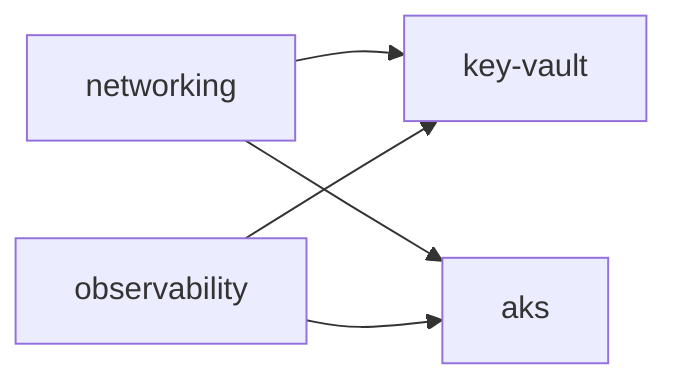

# secure-azure-platform

The flagship repo of a portfolio built to demonstrate Lead/Staff-level
platform engineering and security practice. `v0.1` is a minimal but real
Azure landing zone, built with Terraform.

Design: `docs/superpowers/specs/2026-09-02-v0.1-landing-zone-design.md`.
Decisions: `docs/decisions/`.

## Stacks

One Terraform state file per lifecycle-aligned stack
(`environments/dev/<stack>/`), cross-referenced via `terraform_remote_state`.
See [ADR 0001](docs/decisions/0001-lifecycle-aligned-stacks.md) for why.

| Stack | Creates | Depends on |
|---|---|---|
| [`networking`](environments/dev/networking) | VNet, subnet | — |
| [`observability`](environments/dev/observability) | Log Analytics workspace | — |
| [`key-vault`](environments/dev/key-vault) | Platform Key Vault | `networking`, `observability` |
| [`aks`](environments/dev/aks) | AKS cluster (hardened) | `networking`, `observability` |

The three Entra RBAC groups (`sap-dev-humans` = `Contributor`,
`sap-dev-ci-plan` = `Reader`, `sap-dev-ci-apply` = `Contributor`) are created
and membership-managed by a directory admin outside this repo, as assigned
cloud-only security groups. `bootstrap/` creates one resource group per stack
and assigns those groups their roles on it — the CI identities hold no
subscription-scoped role. See [`bootstrap/README.md`](bootstrap/README.md)
and [ADR 0002](docs/decisions/0002-resource-groups-in-bootstrap.md).

Modules come from the already-released
[`jmsalvo/terraform-azure-modules`](https://github.com/jmsalvo/terraform-azure-modules)
at `?ref=v0.1.0` wherever one exists (`naming`, `networking`, `key-vault`),
and at `?ref=v0.2.0` for `aks`; plain `azurerm` resources where no module
exists (`observability`'s Log Analytics workspace — no module wraps a
single resource).

## First-time rollout

Layered remote state means a downstream stack's `plan` needs the upstream
stack's state to already exist in the backend, not just its code to exist
in the same PR. Bringing the whole landing zone up from nothing:

1. Directory admin creates the three Entra groups and makes the operator an
   owner of each (`bootstrap/README.md`).
2. `bootstrap/` — run once by hand (`bootstrap/README.md`). Creates the state
   storage account, the two CI managed identities, one resource group per
   stack, and every role assignment (the CI groups' per-resource-group roles,
   plus the operators' Key Vault data-plane role).
3. Complete the remaining manual steps in `bootstrap/README.md` — the CI
   identities into their groups, GitHub repository variables, the `dev-apply`
   environment, and the state storage account name into each `backend.hcl`.
4. Merge a PR touching `environments/dev/networking/` and
   `environments/dev/observability/` (together or separately — neither has an
   upstream stack).
5. Merge a PR touching `environments/dev/key-vault/` — needs `networking` and
   `observability` to have real applied state.

After this, ordinary changes to any one stack merge and apply normally; this
sequence only matters once, from an empty subscription.

## How it's tested

CI (`.github/workflows/ci.yml`) runs on every PR and on `main`:

| Check | Scope | Credentials |
|---|---|---|
| `terraform fmt -check` | whole repo | none |
| `terraform validate` | `bootstrap/` + every stack | none |
| `tflint` + azurerm ruleset | whole repo | none |
| `trivy config` | whole repo | none |
| `terraform plan` | changed stacks, on PRs | OIDC, `sap-dev-ci-plan` (Reader per resource group) |
| `terraform apply` | changed stacks, on merge to `main`, dependency-ordered | OIDC, `sap-dev-ci-apply` (Contributor per resource group), gated by the `dev-apply` GitHub Environment |

`scripts\check.ps1` runs the credential-free checks locally (Windows).

## Security considerations

- No stored Azure client secret anywhere — CI authenticates via OIDC /
  workload identity federation; local runs use `az login`.
- No Microsoft Graph or directory write access anywhere. The CI identities
  are user-assigned managed identities with Azure RBAC only; the Entra groups
  they belong to are created and membership-managed by a directory admin
  outside this repo. A compromised CI identity cannot alter group membership
  or any other directory object.
- The CI identities hold no subscription-scoped role. `bootstrap/` (run by a
  human subscription Owner) grants them `Reader` / `Contributor` on each
  stack's resource group only, and neither identity can create role
  assignments — a leaked apply token reaches three named resource groups, not
  the subscription. Both additionally hold `Storage Blob Data Contributor` on
  the state storage account — data-plane only, for the state-lock blob lease,
  not a control-plane or role-assignment permission. See [ADR 0002](docs/decisions/0002-resource-groups-in-bootstrap.md).
- Untrusted pull requests can only run a `Reader`-scoped `plan`, never
  mutate infrastructure — `apply` runs only on merged commits to `main`,
  via a separate federated credential, gated by branch protection and the
  `dev-apply` GitHub Environment.
- The Key Vault is RBAC-authorized (no access policies), purge-protected,
  and network-restricted by default (see `environments/dev/key-vault/README.md`).
- `trivy config` scans every stack's HCL for insecure defaults on every
  change.
- Provider versions are pinned in committed `.terraform.lock.hcl` files and
  CI inits with `-lockfile=readonly`, so a provider can't change under CI
  between a reviewed `plan` and the `apply` that follows it.

**Known limitation — the approved `apply` is not the reviewed `plan`.**
`apply_*` jobs currently re-run `terraform plan` internally rather than
applying a `-out=tfplan` artifact produced by the PR's `plan-*` job. Plan
runs on `pull_request` and apply runs on `push` to `main`, so the two never
share a workflow run and no plan file crosses between them. The practical
consequence: the `dev-apply` environment reviewer is approving *the job*,
not a specific reviewed plan, and what applies is not provably identical to
what was reviewed. Closing this gap (passing a plan artifact from the PR
into the post-merge apply) is a known follow-up, not yet implemented.

## Teardown

See `bootstrap/README.md`'s Teardown section — stacks must be destroyed in
reverse dependency order, `bootstrap/` last.

## Contributing

See [`CONTRIBUTING.md`](CONTRIBUTING.md). PR-based workflow, Conventional
Commits, CI green before merge.

## License

[MIT](LICENSE) © 2026 Jennifer Salvo
