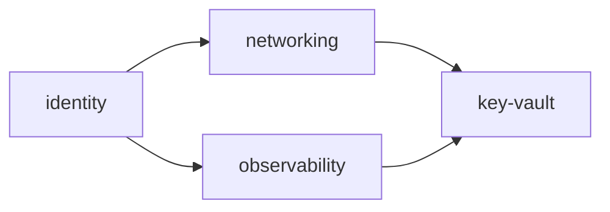

# secure-azure-platform

The flagship repo of a portfolio built to demonstrate Lead/Staff-level
platform engineering and security practice. `v0.1` is a minimal but real
Azure landing zone, built with Terraform.

Design: `docs/superpowers/specs/2026-09-02-v0.1-landing-zone-design.md`.
Decisions: `docs/decisions/`.

## Stacks

One Terraform state file per lifecycle-aligned stack
(`environments/dev/<stack>/`), cross-referenced via `terraform_remote_state`.
See [ADR 0001](docs/decisions/0001-lifecycle-aligned-stacks.md) for why.

| Stack | Creates | Depends on |
|---|---|---|
| [`identity`](environments/dev/identity) | 3 Entra RBAC groups | — |
| [`networking`](environments/dev/networking) | VNet, subnet, RBAC | `identity` |
| [`observability`](environments/dev/observability) | Log Analytics workspace, RBAC | `identity` |
| [`key-vault`](environments/dev/key-vault) | Platform Key Vault, RBAC | all three above |

Modules come from the already-released
[`jmsalvo/terraform-azure-modules`](https://github.com/jmsalvo/terraform-azure-modules)
at `?ref=v0.1.0` wherever one exists (`naming`, `networking`, `key-vault`);
plain `azurerm`/`azuread` resources where it doesn't (`identity`'s groups,
`observability`'s workspace — no module wraps a single resource).

## First-time rollout

Layered remote state means a downstream stack's `plan` needs the upstream
stack's state to already exist in the backend, not just its code to exist
in the same PR. Bringing the whole landing zone up from nothing:

1. `bootstrap/` — run once by hand (`bootstrap/README.md`). Creates the
   state storage account and the two CI OIDC app registrations.
2. Complete the manual steps in `bootstrap/README.md` (GitHub variables,
   `Group.ReadWrite.All` grant, `dev-apply` environment).
3. Merge a PR touching only `environments/dev/identity/` — its `apply` job
   has no upstream dependency.
4. Merge a PR touching `environments/dev/networking/` and
   `environments/dev/observability/` (together or separately — both only
   need `identity`'s state to exist, which step 3 created).
5. Merge a PR touching `environments/dev/key-vault/` — needs all three
   above to have real applied state.

After this, ordinary changes to any one stack merge and apply normally;
this sequence only matters once, from an empty subscription.

## How it's tested

CI (`.github/workflows/ci.yml`) runs on every PR and on `main`:

| Check | Scope | Credentials |
|---|---|---|
| `terraform fmt -check` | whole repo | none |
| `terraform validate` | `bootstrap/` + every stack | none |
| `tflint` + azurerm ruleset | whole repo | none |
| `trivy config` | whole repo | none |
| `terraform plan` | changed stacks, on PRs | OIDC, `sap-dev-ci-plan` (Reader) |
| `terraform apply` | changed stacks, on merge to `main`, dependency-ordered | OIDC, `sap-dev-ci-apply` (Contributor), gated by the `dev-apply` GitHub Environment |

`scripts\check.ps1` runs the credential-free checks locally (Windows).

## Security considerations

- No stored Azure client secret anywhere — CI authenticates via OIDC /
  workload identity federation; local runs use `az login`.
- Untrusted pull requests can only run a `Reader`-scoped `plan`, never
  mutate infrastructure — `apply` runs only on merged commits to `main`,
  via a separate federated credential, gated by branch protection and the
  `dev-apply` GitHub Environment.
- The Key Vault is RBAC-authorized (no access policies), purge-protected,
  and network-restricted by default (see `environments/dev/key-vault/README.md`).
- `trivy config` scans every stack's HCL for insecure defaults on every
  change.

## Teardown

See `bootstrap/README.md`'s Teardown section — stacks must be destroyed in
reverse dependency order, `bootstrap/` last.

## Contributing

See [`CONTRIBUTING.md`](CONTRIBUTING.md). PR-based workflow, Conventional
Commits, CI green before merge.

## License

[MIT](LICENSE) © 2026 Jennifer Salvo
