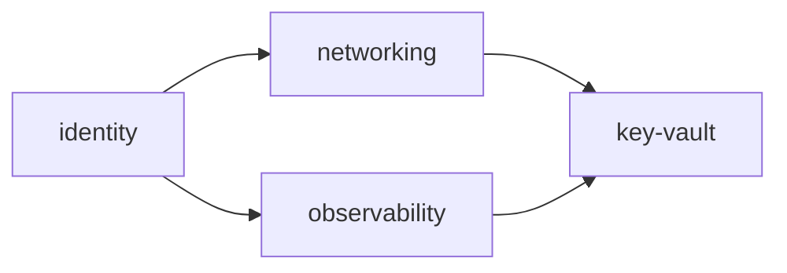

# `v0.1` Landing Zone Implementation Plan

> **For agentic workers:** REQUIRED SUB-SKILL: Use superpowers:subagent-driven-development (recommended) or superpowers:executing-plans to implement this plan task-by-task. Steps use checkbox (`- [ ]`) syntax for tracking.

**Goal:** Stand up the `secure-azure-platform` repo and its `v0.1` Azure landing
zone — four lifecycle-aligned Terraform stacks (`identity`, `networking`,
`observability`, `key-vault`), a one-time `bootstrap/` config, and a
GitHub-Actions CI pipeline authenticating to Azure via OIDC — so that once the
user's personal Azure/Entra tenant exists, `terraform apply` in each stack
produces a real, minimal, secure landing zone.

**Architecture:** New repo, scaffolded to match `terraform-azure-modules`'
conventions (README/CI/docs shape) but adapted for root/environment configs
rather than reusable modules: no `terraform test`/Terratest (nothing to mock —
these are real Azure resources), no `terraform-docs` (no external consumers of
an environment config's inputs). `bootstrap/` is a local-state config, run
once by hand, that creates everything CI needs before it can authenticate
(state storage account, two OIDC app registrations + federated credentials).
Every other stack is a `backend "azurerm"` remote-state root module under
`environments/dev/<stack>/`, composing modules from the already-released
`jmsalvo/terraform-azure-modules@v0.1.0` where one exists (`naming`,
`networking`, `key-vault`) and plain `azurerm`/`azuread` resources where it
doesn't (`identity`'s Entra groups, `observability`'s Log Analytics
workspace). Stacks read each other's outputs via `terraform_remote_state`.

**Tech Stack:** Terraform >= 1.6 (CI/local pinned 1.16.0, matching
`terraform-azure-modules`), `azurerm` provider `~> 4.0`, `azuread` provider
`~> 3.0`, GitHub Actions with OIDC (`id-token: write`), tflint + azurerm
ruleset, trivy config scan.

**Spec:** `secure-azure-platform/docs/superpowers/specs/2026-09-02-v0.1-landing-zone-design.md`

## Global Constraints

- Modules are consumed pinned: `source = "github.com/jmsalvo/terraform-azure-modules//modules/<name>?ref=v0.1.0"` — never `?ref=main`.
- One Terraform state file per stack, per environment; cross-stack references only via `terraform_remote_state`, never hardcoded IDs.
- No stored Azure client secret anywhere (CI or local) — OIDC / `az login` only.
- Three Entra groups (`sap-dev-humans` = `Contributor`, `sap-dev-ci-plan` = `Reader`, `sap-dev-ci-apply` = `Contributor`), each granted per-resource-group by the stack that owns that resource group — never centralized in `identity`.
- Apply order: `identity` first (no dependencies) → `networking` and `observability` in parallel (depend on `identity`'s group object IDs) → `key-vault` last (depends on all three).
- `workload = "sap"`, `environment = "dev"`, `location = "eastus2"` — consistent across every stack so the `naming` module produces a coherent name family. Resource group names are the literal `rg-sap-dev-<stack>` strings already committed to in the spec, not `naming`-module-derived (the module's default RG pattern doesn't match that shape).
- Nothing in this plan can actually `terraform apply` for real until the user's personal Azure/Entra tenant exists (`plan/docs/status.md` user to-do). Every task's deliverable is `terraform validate` / `plan` correctness, not a live apply.

---

## Task 1: Repo scaffold

**Files:**
- Create: `README.md`, `LICENSE`, `CHANGELOG.md`, `CONTRIBUTING.md`, `.gitignore`, `.gitattributes`, `.tflint.hcl`, `.pre-commit-config.yaml`, `trivy.yaml`, `scripts/check.ps1`, `docs/decisions/README.md`, `docs/decisions/0001-lifecycle-aligned-stacks.md`, `docs/evidence/.gitkeep`

**Interfaces:**
- Produces: the repo-wide conventions (`.tflint.hcl`, `trivy.yaml` severity gate, `scripts/check.ps1`) every later task's verification steps rely on.

- [ ] **Step 1: Write `.gitignore` and `.gitattributes`**

`.gitignore`:

```gitignore
# Terraform
**/.terraform/*
*.tfstate
*.tfstate.*
crash.log
crash.*.log
*.tfvars
*.tfvars.json
override.tf
override.tf.json
*_override.tf
*_override.tf.json
.terraformrc
terraform.rc
.terraform.lock.hcl

# Editors / OS
.idea/
.vscode/
*.swp
.DS_Store
Thumbs.db
```

`.gitattributes`:

```gitattributes
# Normalise line endings to LF in the repo and on checkout, so `terraform fmt`
# and other tools behave identically on every platform.
* text=auto eol=lf

*.png binary
*.jpg binary
*.gif binary
*.ico binary
```

- [ ] **Step 2: Write `.tflint.hcl` and `trivy.yaml`**

`.tflint.hcl` — `call_module_type = "local"`, not `"all"`: every stack here
calls remote git-sourced modules (`github.com/jmsalvo/terraform-azure-modules//...`),
already linted and tested in their own repo's CI. Recursing into them would
require tflint to fetch git sources during lint, which isn't reliable in CI
without a prior `terraform init`:

```hcl
config {
  call_module_type = "local"
}

plugin "terraform" {
  enabled = true
  preset  = "recommended"
}

plugin "azurerm" {
  enabled = true
  version = "0.27.0"
  source  = "github.com/terraform-linters/tflint-ruleset-azurerm"
}
```

`trivy.yaml` (identical gate to `terraform-azure-modules`, for consistency
across the portfolio):

```yaml
# Single source of truth for Trivy, shared by CI (.github/workflows/ci.yml) and
# local runs. Trivy auto-loads ./trivy.yaml from the working directory; CI passes
# it explicitly via the action's `trivy-config` input.
#
# Reference: https://trivy.dev/latest/docs/references/configuration/config-file/

# Fail a run (exit 1) on any misconfiguration at or above these severities.
severity:
  - HIGH
  - CRITICAL

exit-code: 1

# Reviewed suppressions go here (see https://trivy.dev/latest/docs/configuration/filtering/).
# ignorefile: .trivyignore
```

- [ ] **Step 3: Write `.pre-commit-config.yaml`**

Same tool family as `terraform-azure-modules`, minus the `terraform_docs`
hook (no module-consumption docs to keep in sync here):

```yaml
# Optional local hooks. Not required to contribute; CI is the source of truth.
#   pip install pre-commit && pre-commit install
repos:
  - repo: https://github.com/antonbabenko/pre-commit-terraform
    rev: v1.96.1
    hooks:
      - id: terraform_fmt
      - id: terraform_validate
      - id: terraform_tflint
        args:
          - --args=--recursive
      - id: terraform_trivy
        # Severity + exit-code come from ./trivy.yaml (auto-loaded from the repo root).

  - repo: https://github.com/pre-commit/pre-commit-hooks
    rev: v4.6.0
    hooks:
      - id: end-of-file-fixer
      - id: trailing-whitespace
      - id: check-merge-conflict
      - id: check-yaml
```

- [ ] **Step 4: Write `scripts/check.ps1`**

Adapted from `terraform-azure-modules`: scans `bootstrap/` and
`environments/*/*/` instead of `modules/*/`; no `terraform test` loop (no
`tests/` dirs — these are live root configs, not reusable modules with mocked
behaviour tests); no `terraform-docs` loop.

```powershell
<#
.SYNOPSIS
    Runs the credential-free CI checks locally on Windows, no bash required.

.DESCRIPTION
    Mirrors the credential-free jobs in .github/workflows/ci.yml: terraform
    fmt, terraform validate (bootstrap + every stack, backend disabled), tflint,
    and the trivy config scan. Run it before pushing a branch. Does not run
    terraform plan/apply — those need Azure OIDC credentials CI provides.

    Every tool is a native Windows binary (install with:
      scoop install terraform tflint trivy
    ).

.PARAMETER Fix
    Auto-fix formatting with `terraform fmt` instead of only checking.

.EXAMPLE
    .\scripts\check.ps1

.EXAMPLE
    .\scripts\check.ps1 -Fix
#>
[CmdletBinding()]
param(
    [switch]$Fix
)

$ErrorActionPreference = 'Stop'
$global:LASTEXITCODE = 0

$RepoRoot = Split-Path -Parent $PSScriptRoot
Push-Location $RepoRoot
try {
    $failures = New-Object System.Collections.Generic.List[string]

    function Test-Tool {
        param([string]$Name)
        return [bool](Get-Command $Name -ErrorAction SilentlyContinue)
    }

    function Invoke-Step {
        param(
            [string]$Name,
            [scriptblock]$Body
        )
        Write-Host ''
        Write-Host "==> $Name" -ForegroundColor Cyan
        & $Body
        if ($LASTEXITCODE -ne 0) {
            Write-Host "    FAILED: $Name" -ForegroundColor Red
            $failures.Add($Name)
        }
        else {
            Write-Host '    ok' -ForegroundColor Green
        }
    }

    # --- tool presence ---------------------------------------------------------
    $missing = @('terraform', 'tflint', 'trivy') | Where-Object { -not (Test-Tool $_) }
    if ($missing) {
        Write-Host "Missing tools: $($missing -join ', ')" -ForegroundColor Red
        Write-Host "Install with: scoop install $($missing -join ' ')" -ForegroundColor Yellow
        exit 1
    }

    # --- directories ---------------------------------------------------------
    $tfDirs = @('bootstrap') + (Get-ChildItem -Path 'environments' -Recurse -Filter '*.tf' -File |
        Where-Object { $_.FullName -notmatch '\\\.terraform\\' } |
        ForEach-Object { $_.DirectoryName } |
        Select-Object -Unique) | Sort-Object -Unique

    # --- fmt ---------------------------------------------------------
    if ($Fix) {
        Invoke-Step 'terraform fmt (rewrite)' { terraform fmt -recursive | Out-Host }
    }
    else {
        Invoke-Step 'terraform fmt -check' { terraform fmt -check -recursive -diff | Out-Host }
    }

    # --- validate ---------------------------------------------------------
    foreach ($dir in $tfDirs) {
        $rel = Resolve-Path -Relative $dir
        Invoke-Step "terraform validate $rel" {
            terraform "-chdir=$dir" init -backend=false -input=false -no-color | Out-Host
            if ($LASTEXITCODE -eq 0) {
                terraform "-chdir=$dir" validate -no-color | Out-Host
            }
        }
    }

    # --- tflint ---------------------------------------------------------
    Invoke-Step 'tflint --init' { tflint --init | Out-Host }
    Invoke-Step 'tflint --recursive' { tflint --recursive --no-color | Out-Host }

    # --- trivy ---------------------------------------------------------
    Invoke-Step 'trivy config' { trivy config --config trivy.yaml . | Out-Host }

    # --- summary ---------------------------------------------------------
    Write-Host ''
    if ($failures.Count -gt 0) {
        Write-Host "FAILED ($($failures.Count)):" -ForegroundColor Red
        $failures | ForEach-Object { Write-Host "  - $_" -ForegroundColor Red }
        exit 1
    }
    Write-Host 'All checks passed.' -ForegroundColor Green
    exit 0
}
finally {
    Pop-Location
}
```

- [ ] **Step 5: Write `LICENSE`, `CONTRIBUTING.md`, `CHANGELOG.md`**

`LICENSE` (MIT, same as `terraform-azure-modules`):

```
MIT License

Copyright (c) 2026 Jennifer Salvo

Permission is hereby granted, free of charge, to any person obtaining a copy
of this software and associated documentation files (the "Software"), to deal
in the Software without restriction, including without limitation the rights
to use, copy, modify, merge, publish, distribute, sublicense, and/or sell
copies of the Software, and to permit persons to whom the Software is
furnished to do so, subject to the following conditions:

The above copyright notice and this permission notice shall be included in all
copies or substantial portions of the Software.

THE SOFTWARE IS PROVIDED "AS IS", WITHOUT WARRANTY OF ANY KIND, EXPRESS OR
IMPLIED, INCLUDING BUT NOT LIMITED TO THE WARRANTIES OF MERCHANTABILITY,
FITNESS FOR A PARTICULAR PURPOSE AND NONINFRINGEMENT. IN NO EVENT SHALL THE
AUTHORS OR COPYRIGHT HOLDERS BE LIABLE FOR ANY CLAIM, DAMAGES OR OTHER
LIABILITY, WHETHER IN AN ACTION OF CONTRACT, TORT OR OTHERWISE, ARISING FROM,
OUT OF OR IN CONNECTION WITH THE SOFTWARE OR THE USE OR OTHER DEALINGS IN THE
SOFTWARE.
```

`CONTRIBUTING.md`:

````markdown
# Contributing

This is a single-operator portfolio repo, but the workflow mirrors a real
team's: PR-based, CI-gated, Conventional Commits.

## Workflow

1. Branch from `main`.
2. Make the change. Stack changes need `terraform validate` (and `terraform
   plan` once Azure credentials exist) passing before merge.
3. Run the local checks below.
4. Open a PR. CI must be green to merge; merging to `main` triggers `apply`
   for any stack whose files changed (see root `README.md` for the CI shape).
5. Commits follow [Conventional Commits](https://www.conventionalcommits.org/)
   (`feat:`, `fix:`, `docs:`, `chore:`, `ci:`, `refactor:`).

## Tooling

| Tool | Version | Purpose |
|------|---------|---------|
| Terraform | >= 1.6 required; CI and local use 1.16.x | `fmt`, `validate`, `plan`, `apply` |
| tflint | latest | lint + azurerm ruleset |
| trivy | latest | IaC misconfiguration scan |
| Azure CLI | latest | `az login` for local runs against the real tenant |
| pre-commit | optional | runs fmt/validate/tflint/trivy on `git commit` (macOS/Linux, or Windows + Git Bash) |

Windows contributors: `scripts\check.ps1` runs the credential-free checks
natively — see below.

## Local checks

**Windows** (no bash needed):

```powershell
.\scripts\check.ps1          # check everything (fmt, validate, tflint, trivy)
.\scripts\check.ps1 -Fix     # also auto-run `terraform fmt`
```

**macOS / Linux** — either the pre-commit hooks:

```bash
pipx install pre-commit   # or: pip install pre-commit
pre-commit install
pre-commit run --all-files
```

or by hand:

```bash
terraform fmt -check -recursive
for d in bootstrap environments/*/*/; do
  terraform -chdir="$d" init -backend=false && terraform -chdir="$d" validate
done
tflint --init && tflint --recursive
trivy config --config trivy.yaml .
```

## Adding a stack

- `environments/dev/<stack>/` with `versions.tf`, `main.tf`, `variables.tf`,
  `outputs.tf`, `backend.hcl`, `README.md`.
- Add the stack's `plan`/`apply` jobs to `.github/workflows/ci.yml`, wired
  into the `needs:` graph at the correct dependency tier (see root
  `README.md`'s stack dependency diagram).
- Note the change in `CHANGELOG.md` under `## [Unreleased]`.

## Making changes to an existing stack

Same as adding one, minus the CI wiring. If the change adds a new
cross-stack dependency, update the `needs:` graph and the root README's
dependency diagram together — they must not drift.
````

`CHANGELOG.md`:

```markdown
# Changelog

All notable changes to this repo are documented here.

## [Unreleased]

### Added
```

- [ ] **Step 6: Write `docs/decisions/README.md` and ADR 0001**

`docs/decisions/README.md`:

```markdown
# Architecture Decision Records

Numbered, dated decisions with context and rationale — not a running log of
every choice, just the ones worth explaining to a future reader (including
future-me in an interview).
```

`docs/decisions/0001-lifecycle-aligned-stacks.md`:

````markdown
# 0001 — Lifecycle-aligned Terraform stacks, not one state per environment

- **Status:** Accepted
- **Date:** 2026-09-01

## Context

Every resource in this landing zone lives in one `dev` environment. The
naive split is one Terraform state file per environment. But the resources
within `dev` don't share a lifecycle: an Entra group and a Key Vault change
for completely different reasons, at completely different times, and a
single shared state file would force every `apply` to consider all of them
together — the wrong blast radius for a change to any one of them.

## Decision

One state file per **lifecycle-aligned stack**, per environment, under
`environments/<env>/<stack>/`:

- `identity/` — three Entra groups. No dependencies.
- `networking/` — VNet, subnets. Depends on `identity` (assigns RBAC roles to
  its groups on its own resource group).
- `observability/` — Log Analytics workspace. Same dependency shape as
  `networking`.
- `key-vault/` — the platform Key Vault. Depends on all three above (subnet
  ID, group object IDs, workspace ID).

Stacks reference each other's outputs via native `terraform_remote_state`
data sources. No Terragrunt or Terraform Stacks — the dependency graph here
is four nodes deep at most, and native Terraform expresses that with nothing
extra to install or learn.

## Rationale

- **Blast radius matches intent.** A `key-vault` network-rule change cannot
  accidentally touch the VNet; an `identity` group-membership change cannot
  accidentally touch a resource group's RBAC (only the stack that assigns a
  role can drift that assignment, and only when that stack itself changes).
- **Independent apply cadence.** `identity` changes rarely (new group, new
  member); `key-vault` may change often (new secret consumer, network rule
  tweak). Coupling their state would force one's noise onto the other.
- **Matches the resource-container boundary.** Every stack with ARM
  resources gets exactly one resource group; the Terraform state boundary
  and the resource-group boundary are the same boundary everywhere they both
  exist.

## Alternative: one state file per environment

Simpler to set up (one backend config, one `apply`), and fine at very small
scale. Rejected here because the stacks already have genuinely different
change frequencies and blast-radius requirements even at four stacks — the
coarse split would have been the wrong default to carry into `v0.2` onward,
where the stack count only grows (`aks/` at `v0.2`, likely `policy/` at
`v0.4`).

## Consequences

- Four `terraform init`/`plan`/`apply` cycles instead of one — more moving
  parts in CI (see root `README.md`'s job graph), but each cycle is smaller
  and safer.
- Cross-stack references go through `terraform_remote_state`, which means a
  downstream stack's `plan` needs the upstream stack's state to already
  exist in the remote backend — not just its code to exist in this PR's
  diff. First-time rollout order matters (see root `README.md`).

## Revisit when

The stack count grows enough (roughly eight-plus) or a second CI system
enters the picture that hand-maintained `needs:` chains in one workflow stop
being the more legible option — at that point, Terragrunt or Terraform
Stacks becomes worth the added tooling.
````

- [ ] **Step 7: Create `docs/evidence/.gitkeep`, seed CHANGELOG, and commit**

```bash
mkdir -p docs/evidence
touch docs/evidence/.gitkeep
```

```bash
cd secure-azure-platform
git add .gitignore .gitattributes .tflint.hcl .pre-commit-config.yaml trivy.yaml scripts/check.ps1 LICENSE CONTRIBUTING.md CHANGELOG.md docs/decisions docs/evidence
git commit -m "chore: repo scaffold (conventions, tooling, ADR 0001)"
```

(`README.md` is written last, in Task 8, once there's a stack dependency
diagram and CI shape to describe — it's excluded from this commit.)

---

## Task 2: `bootstrap/` — state storage + OIDC app registrations

**Files:**
- Create: `bootstrap/versions.tf`, `bootstrap/variables.tf`, `bootstrap/main.tf`, `bootstrap/outputs.tf`, `bootstrap/terraform.tfvars.example`, `bootstrap/README.md`

**Interfaces:**
- Produces (Terraform outputs, read by hand after `apply` and copied into
  later tasks — see `bootstrap/README.md`): `tfstate_resource_group_name`
  (string, always `"rg-sap-dev-bootstrap"`), `tfstate_storage_account_name`
  (string), `tfstate_container_name` (string, always `"tfstate"`),
  `ci_plan_client_id` (string), `ci_plan_service_principal_object_id`
  (string), `ci_apply_client_id` (string),
  `ci_apply_service_principal_object_id` (string), `tenant_id` (string),
  `subscription_id` (string).

- [ ] **Step 1: Write `bootstrap/versions.tf`**

```hcl
terraform {
  required_version = ">= 1.6.0"

  required_providers {
    azurerm = {
      source  = "hashicorp/azurerm"
      version = "~> 4.0"
    }
    azuread = {
      source  = "hashicorp/azuread"
      version = "~> 3.0"
    }
  }

  # Local state deliberately: this config creates the remote-state backend
  # every other stack uses, so it can't use that backend itself.
}

provider "azurerm" {
  features {}
}

provider "azuread" {}

data "azurerm_client_config" "current" {}
```

- [ ] **Step 2: Write `bootstrap/variables.tf`**

```hcl
variable "location" {
  description = "Azure region for the bootstrap resource group and storage account."
  type        = string
  default     = "eastus2"
}

variable "github_repository" {
  description = "GitHub \"owner/repo\" the OIDC federated credentials trust, for example \"jmsalvo/secure-azure-platform\"."
  type        = string
}
```

- [ ] **Step 3: Write `bootstrap/main.tf` — state storage account**

```hcl
module "naming" {
  source = "github.com/jmsalvo/terraform-azure-modules//modules/naming?ref=v0.1.0"

  workload    = "sap"
  environment = "dev"
  location    = var.location
  suffix      = ["tfstate"]
}

resource "azurerm_resource_group" "bootstrap" {
  name     = "rg-sap-dev-bootstrap"
  location = var.location
  tags     = module.naming.tags
}

resource "azurerm_storage_account" "tfstate" {
  name                = module.naming.names["storage_account"]
  resource_group_name = azurerm_resource_group.bootstrap.name
  location            = var.location

  account_tier              = "Standard"
  account_replication_type  = "LRS"
  min_tls_version           = "TLS1_2"
  shared_access_key_enabled = false # force Entra ID auth for state access, no account key

  blob_properties {
    versioning_enabled = true
  }

  tags = module.naming.tags
}

resource "azurerm_storage_container" "tfstate" {
  name               = "tfstate"
  storage_account_id = azurerm_storage_account.tfstate.id
}
```

- [ ] **Step 4: Write `bootstrap/main.tf` (append) — OIDC app registrations**

```hcl
resource "azuread_application" "ci_plan" {
  display_name = "sap-dev-ci-plan"
}

resource "azuread_service_principal" "ci_plan" {
  client_id = azuread_application.ci_plan.client_id
}

resource "azuread_application_federated_identity_credential" "ci_plan_pull_request" {
  application_id = azuread_application.ci_plan.id
  display_name   = "github-pull-request"
  description    = "Federated credential for terraform plan on pull requests."
  audiences      = ["api://AzureADTokenExchange"]
  issuer         = "https://token.actions.githubusercontent.com"
  subject        = "repo:${var.github_repository}:pull_request"
}

resource "azuread_application" "ci_apply" {
  display_name = "sap-dev-ci-apply"
}

resource "azuread_service_principal" "ci_apply" {
  client_id = azuread_application.ci_apply.client_id
}

resource "azuread_application_federated_identity_credential" "ci_apply_main" {
  application_id = azuread_application.ci_apply.id
  display_name   = "github-push-main"
  description    = "Federated credential for terraform apply on merge to main."
  audiences      = ["api://AzureADTokenExchange"]
  issuer         = "https://token.actions.githubusercontent.com"
  subject        = "repo:${var.github_repository}:ref:refs/heads/main"
}
```

- [ ] **Step 5: Write `bootstrap/main.tf` (append) — state-blob RBAC for the two CI identities**

`shared_access_key_enabled = false` means state access is Entra-ID-only;
each CI identity needs an explicit data-plane role on the storage account
(separate from, and in addition to, the Reader/Contributor role the
`identity` stack's groups later get on each resource group — this is about
reading/writing the *state blob*, not the resources the state describes):

```hcl
resource "azurerm_role_assignment" "tfstate_ci_plan_read" {
  scope                = azurerm_storage_account.tfstate.id
  role_definition_name = "Storage Blob Data Reader"
  principal_id          = azuread_service_principal.ci_plan.object_id
}

resource "azurerm_role_assignment" "tfstate_ci_apply_write" {
  scope                = azurerm_storage_account.tfstate.id
  role_definition_name = "Storage Blob Data Contributor"
  principal_id          = azuread_service_principal.ci_apply.object_id
}
```

- [ ] **Step 6: Write `bootstrap/outputs.tf`**

```hcl
output "tfstate_resource_group_name" {
  description = "Resource group holding the remote-state storage account."
  value       = azurerm_resource_group.bootstrap.name
}

output "tfstate_storage_account_name" {
  description = "Storage account holding every stack's remote state. Copy into each stack's backend.hcl."
  value       = azurerm_storage_account.tfstate.name
}

output "tfstate_container_name" {
  description = "Blob container holding every stack's remote state."
  value       = azurerm_storage_container.tfstate.name
}

output "ci_plan_client_id" {
  description = "Client (application) ID of the sap-dev-ci-plan app registration. Copy into the ARM_CLIENT_ID_PLAN GitHub repo variable."
  value       = azuread_application.ci_plan.client_id
}

output "ci_plan_service_principal_object_id" {
  description = "Object ID of the sap-dev-ci-plan service principal. Copy into environments/dev/identity's tfvars."
  value       = azuread_service_principal.ci_plan.object_id
}

output "ci_apply_client_id" {
  description = "Client (application) ID of the sap-dev-ci-apply app registration. Copy into the ARM_CLIENT_ID_APPLY GitHub repo variable."
  value       = azuread_application.ci_apply.client_id
}

output "ci_apply_service_principal_object_id" {
  description = "Object ID of the sap-dev-ci-apply service principal. Copy into environments/dev/identity's tfvars."
  value       = azuread_service_principal.ci_apply.object_id
}

output "tenant_id" {
  description = "Entra tenant ID. Copy into the ARM_TENANT_ID GitHub repo variable."
  value       = data.azurerm_client_config.current.tenant_id
}

output "subscription_id" {
  description = "Azure subscription ID. Copy into the ARM_SUBSCRIPTION_ID GitHub repo variable."
  value       = data.azurerm_client_config.current.subscription_id
}
```

- [ ] **Step 7: Write `bootstrap/terraform.tfvars.example` and `bootstrap/README.md`**

`bootstrap/terraform.tfvars.example`:

```hcl
github_repository = "jmsalvo/secure-azure-platform"
```

`bootstrap/README.md`:

````markdown
# bootstrap

Real Terraform, **local state**, run **once by hand** — this is the
infrastructure that has to predate "clone and go" for every other stack:
the remote-state storage account, and the two OIDC app registrations CI
authenticates as.

## Prerequisites

- Personal Azure subscription + Entra tenant, Global Admin (`plan/docs/status.md` user to-do).
- `az login` as that Global Admin.
- Terraform >= 1.6.

## Run it

```bash
cd bootstrap
cp terraform.tfvars.example terraform.tfvars   # edit if the repo isn't jmsalvo/secure-azure-platform
terraform init
terraform apply
```

## After `apply` — manual steps, in order

1. **Copy `tfstate_storage_account_name`** into the `storage_account_name`
   field of every `environments/dev/<stack>/backend.hcl` file (they ship
   with a `REPLACE_AFTER_BOOTSTRAP` placeholder). Commit the real value —
   it's an account name, not a secret.
2. **Set GitHub repository variables** (Settings → Secrets and variables →
   Actions → Variables — these are non-secret identifiers, safe as `vars`,
   not `secrets`):

   ```bash
   gh variable set ARM_TENANT_ID --body "$(terraform output -raw tenant_id)"
   gh variable set ARM_SUBSCRIPTION_ID --body "$(terraform output -raw subscription_id)"
   gh variable set ARM_CLIENT_ID_PLAN --body "$(terraform output -raw ci_plan_client_id)"
   gh variable set ARM_CLIENT_ID_APPLY --body "$(terraform output -raw ci_apply_client_id)"
   ```
3. **Copy the two service principal object IDs** into
   `environments/dev/identity/terraform.tfvars` (`ci_plan_service_principal_object_id`,
   `ci_apply_service_principal_object_id`) — see that stack's README.
4. **Grant `Group.ReadWrite.All`** (admin-consented Microsoft Graph
   application permission) to the `sap-dev-ci-apply` app registration —
   tracked in `plan/docs/status.md`'s user to-do list. Azure RBAC roles
   don't cover Microsoft Graph objects, so without this the `identity`
   stack's own CI `apply` can't create/manage the Entra groups it owns.
   Portal: Entra ID → App registrations → `sap-dev-ci-apply` → API
   permissions → Add → Microsoft Graph → Application permissions →
   `Group.ReadWrite.All` → Grant admin consent.
5. **Create a GitHub Environment** named `dev-apply` (Settings →
   Environments) with required reviewers, and reference it from every
   `apply-*` job in `.github/workflows/ci.yml` (Task 7) — this is the
   "gated by branch protection and a GitHub Environment" property the
   design spec calls for.

## Teardown

Nothing here is meant to be torn down casually — deleting the storage
account destroys every other stack's state. If the whole landing zone is
being decommissioned, delete stacks in reverse dependency order first
(`key-vault` → `networking`/`observability` → `identity`), then
`terraform destroy` here last.
````

- [ ] **Step 8: Verify and commit**

```bash
cd bootstrap
terraform fmt      # auto-align spacing to canonical gofmt style
terraform init -backend=false
terraform validate
```

Expected: `Success! The configuration is valid.`

```bash
cd ..
git add bootstrap CHANGELOG.md
```

Add to `CHANGELOG.md` under `## [Unreleased]` → `### Added`:
`- bootstrap/: one-time state storage account + OIDC app registrations for CI`

```bash
git commit -m "feat: bootstrap state storage and OIDC app registrations"
```

---

## Task 3: `environments/dev/identity/`

**Files:**
- Create: `environments/dev/identity/versions.tf`, `environments/dev/identity/variables.tf`, `environments/dev/identity/main.tf`, `environments/dev/identity/outputs.tf`, `environments/dev/identity/backend.hcl`, `environments/dev/identity/terraform.tfvars.example`, `environments/dev/identity/README.md`

**Interfaces:**
- Consumes: `bootstrap` outputs `ci_plan_service_principal_object_id`,
  `ci_apply_service_principal_object_id` (copied by hand into
  `terraform.tfvars` per `bootstrap/README.md` — `bootstrap` uses local
  state, so this is a manual copy, not a `terraform_remote_state` read).
- Produces (state read by `networking`/`observability`/`key-vault` via
  `terraform_remote_state`): `humans_group_object_id` (string),
  `ci_plan_group_object_id` (string), `ci_apply_group_object_id` (string).

- [ ] **Step 1: Write `versions.tf`**

```hcl
terraform {
  required_version = ">= 1.6.0"

  required_providers {
    azuread = {
      source  = "hashicorp/azuread"
      version = "~> 3.0"
    }
  }

  backend "azurerm" {}
}

provider "azuread" {}
```

- [ ] **Step 2: Write `variables.tf`**

```hcl
variable "human_operator_object_id" {
  description = "Entra object ID of the human operator, added as a member of sap-dev-humans."
  type        = string
}

variable "ci_plan_service_principal_object_id" {
  description = "Object ID of the sap-dev-ci-plan app registration's service principal (bootstrap output ci_plan_service_principal_object_id)."
  type        = string
}

variable "ci_apply_service_principal_object_id" {
  description = "Object ID of the sap-dev-ci-apply app registration's service principal (bootstrap output ci_apply_service_principal_object_id)."
  type        = string
}
```

- [ ] **Step 3: Write `main.tf`**

```hcl
resource "azuread_group" "humans" {
  display_name     = "sap-dev-humans"
  description      = "Human operator: manual work, debugging, break-glass access to the dev landing zone."
  security_enabled = true
}

resource "azuread_group" "ci_plan" {
  display_name     = "sap-dev-ci-plan"
  description      = "CI identity for terraform plan on pull requests. Reader only."
  security_enabled = true
}

resource "azuread_group" "ci_apply" {
  display_name     = "sap-dev-ci-apply"
  description      = "CI identity for terraform apply on merge to main. Contributor."
  security_enabled = true
}

resource "azuread_group_member" "humans_operator" {
  group_object_id  = azuread_group.humans.object_id
  member_object_id = var.human_operator_object_id
}

resource "azuread_group_member" "ci_plan_service_principal" {
  group_object_id  = azuread_group.ci_plan.object_id
  member_object_id = var.ci_plan_service_principal_object_id
}

resource "azuread_group_member" "ci_apply_service_principal" {
  group_object_id  = azuread_group.ci_apply.object_id
  member_object_id = var.ci_apply_service_principal_object_id
}
```

- [ ] **Step 4: Write `outputs.tf`**

```hcl
output "humans_group_object_id" {
  description = "Object ID of sap-dev-humans, for Contributor role assignments in other stacks."
  value       = azuread_group.humans.object_id
}

output "ci_plan_group_object_id" {
  description = "Object ID of sap-dev-ci-plan, for Reader role assignments in other stacks."
  value       = azuread_group.ci_plan.object_id
}

output "ci_apply_group_object_id" {
  description = "Object ID of sap-dev-ci-apply, for Contributor role assignments in other stacks."
  value       = azuread_group.ci_apply.object_id
}
```

- [ ] **Step 5: Write `backend.hcl` and `terraform.tfvars.example`**

`backend.hcl` (non-secret — account name only; the placeholder is replaced
per `bootstrap/README.md` step 1 and the real value is committed):

```hcl
resource_group_name = "rg-sap-dev-bootstrap"
storage_account_name = "REPLACE_AFTER_BOOTSTRAP"
container_name       = "tfstate"
key                  = "identity.tfstate"
use_azuread_auth     = true
```

`terraform.tfvars.example`:

```hcl
human_operator_object_id             = "00000000-0000-0000-0000-000000000000"
ci_plan_service_principal_object_id  = "00000000-0000-0000-0000-000000000000"
ci_apply_service_principal_object_id = "00000000-0000-0000-0000-000000000000"
```

- [ ] **Step 6: Write `README.md`**

```markdown
# identity

Creates the three Entra RBAC groups every other stack assigns roles to. No
ARM resources, no resource group — Entra ID groups are Microsoft Graph
objects, outside the ARM resource hierarchy.

No dependencies; applies first (see root README's stack dependency
diagram).

## Inputs

`human_operator_object_id` — your own Entra object ID (`az ad signed-in-user
show --query id -o tsv`). `ci_plan_service_principal_object_id` /
`ci_apply_service_principal_object_id` — from `bootstrap`'s outputs, copied
in by hand (see `bootstrap/README.md`).

## First apply

Needs the `Group.ReadWrite.All` admin-consented Graph permission on the
`sap-dev-ci-apply` app registration granted first (`bootstrap/README.md`
step 4) — Azure RBAC doesn't cover Graph objects, so without it this
stack's CI `apply` can't create/manage these groups.
```

- [ ] **Step 7: Verify and commit**

```bash
cd environments/dev/identity
terraform fmt      # auto-align spacing to canonical gofmt style
terraform init -backend=false
terraform validate
```

Expected: `Success! The configuration is valid.`

```bash
cd ../../..
git add environments/dev/identity CHANGELOG.md
```

Add to `CHANGELOG.md`: `- environments/dev/identity/: the three Entra RBAC groups`

```bash
git commit -m "feat: identity stack (Entra RBAC groups)"
```

---

## Task 4: `environments/dev/networking/`

**Files:**
- Create: `environments/dev/networking/versions.tf`, `environments/dev/networking/variables.tf`, `environments/dev/networking/main.tf`, `environments/dev/networking/outputs.tf`, `environments/dev/networking/backend.hcl`, `environments/dev/networking/README.md`

**Interfaces:**
- Consumes (via `terraform_remote_state`, key `identity.tfstate`):
  `humans_group_object_id`, `ci_plan_group_object_id`,
  `ci_apply_group_object_id` (all string, from Task 3).
- Produces: `vnet_id` (string), `platform_subnet_id` (string) — the latter
  consumed by `key-vault` (Task 6) for `network_acls`.

- [ ] **Step 1: Write `versions.tf`**

```hcl
terraform {
  required_version = ">= 1.6.0"

  required_providers {
    azurerm = {
      source  = "hashicorp/azurerm"
      version = "~> 4.0"
    }
  }

  backend "azurerm" {}
}

provider "azurerm" {
  features {}
}
```

- [ ] **Step 2: Write `variables.tf`**

```hcl
variable "location" {
  description = "Azure region for this stack's resources."
  type        = string
  default     = "eastus2"
}

variable "tfstate_storage_account_name" {
  description = "Name of the bootstrap-created storage account holding remote state (bootstrap output tfstate_storage_account_name)."
  type        = string
}
```

- [ ] **Step 3: Write `main.tf`**

```hcl
data "terraform_remote_state" "identity" {
  backend = "azurerm"

  config = {
    resource_group_name  = "rg-sap-dev-bootstrap"
    storage_account_name = var.tfstate_storage_account_name
    container_name        = "tfstate"
    key                   = "identity.tfstate"
    use_azuread_auth      = true
  }
}

module "naming" {
  source = "github.com/jmsalvo/terraform-azure-modules//modules/naming?ref=v0.1.0"

  workload    = "sap"
  environment = "dev"
  location    = var.location
}

resource "azurerm_resource_group" "networking" {
  name     = "rg-sap-dev-networking"
  location = var.location
  tags     = module.naming.tags
}

module "networking" {
  source = "github.com/jmsalvo/terraform-azure-modules//modules/networking?ref=v0.1.0"

  resource_group_name = azurerm_resource_group.networking.name
  location             = var.location
  vnet_name             = module.naming.names["virtual_network"]
  address_space          = ["10.30.0.0/16"]
  tags                    = module.naming.tags

  # Single subnet for v0.1 — no workload exists yet to place elsewhere. The
  # Microsoft.KeyVault service endpoint is what lets key-vault's network_acls
  # allow traffic from this subnet (see environments/dev/key-vault).
  subnets = {
    platform = {
      address_prefixes  = ["10.30.1.0/24"]
      service_endpoints = ["Microsoft.KeyVault"]
    }
  }
}

resource "azurerm_role_assignment" "humans_contributor" {
  scope                = azurerm_resource_group.networking.id
  role_definition_name = "Contributor"
  principal_id           = data.terraform_remote_state.identity.outputs.humans_group_object_id
}

resource "azurerm_role_assignment" "ci_plan_reader" {
  scope                = azurerm_resource_group.networking.id
  role_definition_name = "Reader"
  principal_id           = data.terraform_remote_state.identity.outputs.ci_plan_group_object_id
}

resource "azurerm_role_assignment" "ci_apply_contributor" {
  scope                = azurerm_resource_group.networking.id
  role_definition_name = "Contributor"
  principal_id           = data.terraform_remote_state.identity.outputs.ci_apply_group_object_id
}
```

- [ ] **Step 4: Write `outputs.tf`**

```hcl
output "vnet_id" {
  description = "Resource ID of the VNet."
  value       = module.networking.vnet_id
}

output "platform_subnet_id" {
  description = "Resource ID of the platform subnet, consumed by key-vault's network_acls."
  value       = module.networking.subnet_ids["platform"]
}
```

- [ ] **Step 5: Write `backend.hcl` and `README.md`**

`backend.hcl`:

```hcl
resource_group_name = "rg-sap-dev-bootstrap"
storage_account_name = "REPLACE_AFTER_BOOTSTRAP"
container_name       = "tfstate"
key                  = "networking.tfstate"
use_azuread_auth     = true
```

`README.md`:

```markdown
# networking

VNet + one subnet (`platform`, with the `Microsoft.KeyVault` service
endpoint), plus this stack's own Contributor/Reader role assignments for
the three Entra groups `identity` creates.

Depends on `identity` (reads its remote state for the three group object
IDs — `identity` must have a real applied state in the backend before this
stack's `plan`/`apply` can succeed, not just exist in the same PR's diff).
```

- [ ] **Step 6: Verify and commit**

```bash
cd environments/dev/networking
terraform fmt      # auto-align spacing to canonical gofmt style
terraform init -backend=false
terraform validate
```

Expected: `Success! The configuration is valid.`

```bash
cd ../../..
git add environments/dev/networking CHANGELOG.md
```

Add to `CHANGELOG.md`: `- environments/dev/networking/: VNet, subnet, RBAC role assignments`

```bash
git commit -m "feat: networking stack (VNet, subnet, RBAC)"
```

---

## Task 5: `environments/dev/observability/`

**Files:**
- Create: `environments/dev/observability/versions.tf`, `environments/dev/observability/variables.tf`, `environments/dev/observability/main.tf`, `environments/dev/observability/outputs.tf`, `environments/dev/observability/backend.hcl`, `environments/dev/observability/README.md`

**Interfaces:**
- Consumes (via `terraform_remote_state`, key `identity.tfstate`): same
  three group-object-ID outputs as Task 4.
- Produces: `log_analytics_workspace_id` (string) — consumed by `key-vault`
  (Task 6) for its diagnostic setting.

- [ ] **Step 1: Write `versions.tf`**

Identical to Task 4's, `azurerm ~> 4.0` only.

- [ ] **Step 2: Write `variables.tf`**

Identical shape to Task 4's `variables.tf` (`location` default
`"eastus2"`, `tfstate_storage_account_name`).

- [ ] **Step 3: Write `main.tf`**

```hcl
data "terraform_remote_state" "identity" {
  backend = "azurerm"

  config = {
    resource_group_name  = "rg-sap-dev-bootstrap"
    storage_account_name = var.tfstate_storage_account_name
    container_name        = "tfstate"
    key                   = "identity.tfstate"
    use_azuread_auth      = true
  }
}

module "naming" {
  source = "github.com/jmsalvo/terraform-azure-modules//modules/naming?ref=v0.1.0"

  workload    = "sap"
  environment = "dev"
  location    = var.location
}

resource "azurerm_resource_group" "observability" {
  name     = "rg-sap-dev-observability"
  location = var.location
  tags     = module.naming.tags
}

resource "azurerm_log_analytics_workspace" "this" {
  name                = module.naming.names["log_analytics_workspace"]
  resource_group_name = azurerm_resource_group.observability.name
  location             = var.location
  sku                   = "PerGB2018"
  retention_in_days     = 30
  tags                  = module.naming.tags
}

resource "azurerm_role_assignment" "humans_contributor" {
  scope                = azurerm_resource_group.observability.id
  role_definition_name = "Contributor"
  principal_id           = data.terraform_remote_state.identity.outputs.humans_group_object_id
}

resource "azurerm_role_assignment" "ci_plan_reader" {
  scope                = azurerm_resource_group.observability.id
  role_definition_name = "Reader"
  principal_id           = data.terraform_remote_state.identity.outputs.ci_plan_group_object_id
}

resource "azurerm_role_assignment" "ci_apply_contributor" {
  scope                = azurerm_resource_group.observability.id
  role_definition_name = "Contributor"
  principal_id           = data.terraform_remote_state.identity.outputs.ci_apply_group_object_id
}
```

- [ ] **Step 4: Write `outputs.tf`**

```hcl
output "log_analytics_workspace_id" {
  description = "Resource ID of the Log Analytics workspace, consumed by key-vault's diagnostic setting."
  value       = azurerm_log_analytics_workspace.this.id
}
```

- [ ] **Step 5: Write `backend.hcl` and `README.md`**

`backend.hcl`: same shape as Task 4's, `key = "observability.tfstate"`.

`README.md`:

```markdown
# observability

A single Log Analytics workspace (30-day retention, `PerGB2018` SKU), plus
this stack's own Contributor/Reader role assignments for the three Entra
groups `identity` creates.

Depends on `identity`, same reason and same constraint as `networking`
(see that stack's README). Independent of `networking` — the two apply in
parallel.
```

- [ ] **Step 6: Verify and commit**

```bash
cd environments/dev/observability
terraform fmt      # auto-align spacing to canonical gofmt style
terraform init -backend=false
terraform validate
```

Expected: `Success! The configuration is valid.`

```bash
cd ../../..
git add environments/dev/observability CHANGELOG.md
```

Add to `CHANGELOG.md`: `- environments/dev/observability/: Log Analytics workspace, RBAC role assignments`

```bash
git commit -m "feat: observability stack (Log Analytics workspace, RBAC)"
```

---

## Task 6: `environments/dev/key-vault/`

**Files:**
- Create: `environments/dev/key-vault/versions.tf`, `environments/dev/key-vault/variables.tf`, `environments/dev/key-vault/main.tf`, `environments/dev/key-vault/outputs.tf`, `environments/dev/key-vault/backend.hcl`, `environments/dev/key-vault/README.md`

**Interfaces:**
- Consumes (via `terraform_remote_state`): `identity.tfstate`'s three
  group-object-ID outputs, `networking.tfstate`'s `platform_subnet_id`,
  `observability.tfstate`'s `log_analytics_workspace_id`.
- Produces: `key_vault_id` (string), `key_vault_uri` (string).

- [ ] **Step 1: Write `versions.tf`**

Identical to Task 4's, `azurerm ~> 4.0` only.

- [ ] **Step 2: Write `variables.tf`**

Identical shape to Task 4's `variables.tf`.

- [ ] **Step 3: Write `main.tf`**

```hcl
data "terraform_remote_state" "identity" {
  backend = "azurerm"

  config = {
    resource_group_name  = "rg-sap-dev-bootstrap"
    storage_account_name = var.tfstate_storage_account_name
    container_name        = "tfstate"
    key                   = "identity.tfstate"
    use_azuread_auth      = true
  }
}

data "terraform_remote_state" "networking" {
  backend = "azurerm"

  config = {
    resource_group_name  = "rg-sap-dev-bootstrap"
    storage_account_name = var.tfstate_storage_account_name
    container_name        = "tfstate"
    key                   = "networking.tfstate"
    use_azuread_auth      = true
  }
}

data "terraform_remote_state" "observability" {
  backend = "azurerm"

  config = {
    resource_group_name  = "rg-sap-dev-bootstrap"
    storage_account_name = var.tfstate_storage_account_name
    container_name        = "tfstate"
    key                   = "observability.tfstate"
    use_azuread_auth      = true
  }
}

data "azurerm_client_config" "current" {}

module "naming" {
  source = "github.com/jmsalvo/terraform-azure-modules//modules/naming?ref=v0.1.0"

  workload    = "sap"
  environment = "dev"
  location    = var.location
}

resource "azurerm_resource_group" "key_vault" {
  name     = "rg-sap-dev-key-vault"
  location = var.location
  tags     = module.naming.tags
}

module "key_vault" {
  source = "github.com/jmsalvo/terraform-azure-modules//modules/key-vault?ref=v0.1.0"

  name                 = module.naming.names["key_vault"]
  resource_group_name  = azurerm_resource_group.key_vault.name
  location              = var.location
  tenant_id              = data.azurerm_client_config.current.tenant_id
  tags                   = module.naming.tags

  network_acls = {
    virtual_network_subnet_ids = [data.terraform_remote_state.networking.outputs.platform_subnet_id]
  }

  log_analytics_workspace_id = data.terraform_remote_state.observability.outputs.log_analytics_workspace_id
}

resource "azurerm_role_assignment" "humans_contributor" {
  scope                = azurerm_resource_group.key_vault.id
  role_definition_name = "Contributor"
  principal_id           = data.terraform_remote_state.identity.outputs.humans_group_object_id
}

resource "azurerm_role_assignment" "ci_plan_reader" {
  scope                = azurerm_resource_group.key_vault.id
  role_definition_name = "Reader"
  principal_id           = data.terraform_remote_state.identity.outputs.ci_plan_group_object_id
}

resource "azurerm_role_assignment" "ci_apply_contributor" {
  scope                = azurerm_resource_group.key_vault.id
  role_definition_name = "Contributor"
  principal_id           = data.terraform_remote_state.identity.outputs.ci_apply_group_object_id
}

# RG-level Contributor manages the vault as an ARM resource but does not grant
# data-plane access (the module sets enable_rbac_authorization = true, no
# access policies) — humans additionally need a Key Vault data-plane role to
# actually read/write secrets.
resource "azurerm_role_assignment" "humans_secrets_officer" {
  scope                = module.key_vault.id
  role_definition_name = "Key Vault Secrets Officer"
  principal_id           = data.terraform_remote_state.identity.outputs.humans_group_object_id
}
```

- [ ] **Step 4: Write `outputs.tf`**

```hcl
output "key_vault_id" {
  description = "Resource ID of the Key Vault."
  value       = module.key_vault.id
}

output "key_vault_uri" {
  description = "URI of the Key Vault for client use."
  value       = module.key_vault.vault_uri
}
```

- [ ] **Step 5: Write `backend.hcl` and `README.md`**

`backend.hcl`: same shape as Task 4's, `key = "key-vault.tfstate"`.

`README.md`:

```markdown
# key-vault

The platform-level Key Vault — shared/break-glass admin credentials, shared
TLS certs; not a workload vault (no application workload exists yet at
`v0.1`). Also the integration proof point for the landing zone: the only
stack that reads outputs from all three others, so a successful `apply`
demonstrates the `terraform_remote_state` wiring end-to-end.

`network_acls` restricts data-plane access to the `platform` subnet
`networking` creates (`Microsoft.KeyVault` service endpoint) plus Azure
services (module default). No VM or private endpoint lives in that subnet
yet, so in practice the vault's data plane is Azure-services-only until a
future workload occupies it — the human operator's `Key Vault Secrets
Officer` role assignment is ready for when that changes, but reaching the
vault from a laptop today needs a temporary `network_acls.ip_rules` entry
or `public_network_access_enabled = true`, deliberately not wired up by
default.

Depends on all three other stacks; applies last.
```

- [ ] **Step 6: Verify and commit**

```bash
cd environments/dev/key-vault
terraform fmt      # auto-align spacing to canonical gofmt style
terraform init -backend=false
terraform validate
```

Expected: `Success! The configuration is valid.`

```bash
cd ../../..
git add environments/dev/key-vault CHANGELOG.md
```

Add to `CHANGELOG.md`: `- environments/dev/key-vault/: platform Key Vault, RBAC role assignments`

```bash
git commit -m "feat: key-vault stack (platform vault, RBAC)"
```

---

## Task 7: CI workflow (OIDC, per-stack plan/apply, dependency-ordered)

**Files:**
- Create: `.github/workflows/ci.yml`

**Interfaces:**
- Consumes: GitHub repository variables `ARM_TENANT_ID`,
  `ARM_SUBSCRIPTION_ID`, `ARM_CLIENT_ID_PLAN`, `ARM_CLIENT_ID_APPLY` (set
  per `bootstrap/README.md` step 2); each stack's `tfstate_storage_account_name`
  passed as `-var`, sourced from the same value already committed into
  `backend.hcl` (`grep` extracts it — see Step 4 — so there's exactly one
  place that value lives, not two that could drift); the `dev-apply`
  GitHub Environment (created per `bootstrap/README.md` step 5).

- [ ] **Step 1: Write the credential-free jobs (fmt, validate, tflint, trivy)**

```yaml
name: ci

on:
  pull_request:
  push:
    branches: [main]

permissions:
  contents: read

env:
  TERRAFORM_VERSION: "1.16.0"

jobs:
  fmt:
    runs-on: ubuntu-latest
    steps:
      - uses: actions/checkout@v4
      - uses: hashicorp/setup-terraform@v3
        with:
          terraform_version: ${{ env.TERRAFORM_VERSION }}
      - run: terraform fmt -check -recursive -diff

  validate:
    runs-on: ubuntu-latest
    steps:
      - uses: actions/checkout@v4
      - uses: hashicorp/setup-terraform@v3
        with:
          terraform_version: ${{ env.TERRAFORM_VERSION }}
      - name: terraform validate (bootstrap + every stack)
        shell: bash
        run: |
          set -euo pipefail
          for dir in bootstrap environments/dev/*/; do
            echo "::group::validate ${dir}"
            terraform -chdir="${dir}" init -backend=false -input=false -no-color
            terraform -chdir="${dir}" validate -no-color
            echo "::endgroup::"
          done

  tflint:
    runs-on: ubuntu-latest
    steps:
      - uses: actions/checkout@v4
      - uses: terraform-linters/setup-tflint@v4
        with:
          tflint_version: latest
      - run: tflint --init
      - run: tflint --recursive --no-color

  trivy:
    runs-on: ubuntu-latest
    steps:
      - uses: actions/checkout@v4
      - name: trivy config scan
        uses: aquasecurity/trivy-action@v0.36.0
        with:
          scan-type: config
          scan-ref: .
          trivy-config: trivy.yaml
```

- [ ] **Step 2: Append the changed-stacks detector job**

```yaml
  changes:
    runs-on: ubuntu-latest
    outputs:
      identity: ${{ steps.filter.outputs.identity }}
      networking: ${{ steps.filter.outputs.networking }}
      observability: ${{ steps.filter.outputs.observability }}
      key_vault: ${{ steps.filter.outputs.key_vault }}
    steps:
      - uses: actions/checkout@v4
      - uses: dorny/paths-filter@v3
        id: filter
        with:
          filters: |
            identity:
              - 'environments/dev/identity/**'
            networking:
              - 'environments/dev/networking/**'
            observability:
              - 'environments/dev/observability/**'
            key_vault:
              - 'environments/dev/key-vault/**'
```

- [ ] **Step 3: Append the `plan` jobs (pull requests, `sap-dev-ci-plan` OIDC identity)**

One job per stack, gated on both the credential-free jobs passing and that
stack having changed. All four can run in parallel on a PR — reading
already-applied state via `terraform_remote_state` doesn't require the
other stacks' jobs to run in this workflow:

```yaml
  plan-identity:
    if: github.event_name == 'pull_request' && needs.changes.outputs.identity == 'true'
    needs: [fmt, validate, tflint, trivy, changes]
    runs-on: ubuntu-latest
    permissions:
      contents: read
      id-token: write
    env:
      ARM_CLIENT_ID: ${{ vars.ARM_CLIENT_ID_PLAN }}
      ARM_TENANT_ID: ${{ vars.ARM_TENANT_ID }}
      ARM_SUBSCRIPTION_ID: ${{ vars.ARM_SUBSCRIPTION_ID }}
      ARM_USE_OIDC: "true"
    steps:
      - uses: actions/checkout@v4
      - uses: hashicorp/setup-terraform@v3
        with:
          terraform_version: ${{ env.TERRAFORM_VERSION }}
      - working-directory: environments/dev/identity
        run: |
          terraform init -backend-config=backend.hcl
          terraform plan -input=false -no-color

  plan-networking:
    if: github.event_name == 'pull_request' && needs.changes.outputs.networking == 'true'
    needs: [fmt, validate, tflint, trivy, changes]
    runs-on: ubuntu-latest
    permissions:
      contents: read
      id-token: write
    env:
      ARM_CLIENT_ID: ${{ vars.ARM_CLIENT_ID_PLAN }}
      ARM_TENANT_ID: ${{ vars.ARM_TENANT_ID }}
      ARM_SUBSCRIPTION_ID: ${{ vars.ARM_SUBSCRIPTION_ID }}
      ARM_USE_OIDC: "true"
    steps:
      - uses: actions/checkout@v4
      - uses: hashicorp/setup-terraform@v3
        with:
          terraform_version: ${{ env.TERRAFORM_VERSION }}
      - working-directory: environments/dev/networking
        run: |
          storage_account="$(grep storage_account_name backend.hcl | cut -d'"' -f2)"
          terraform init -backend-config=backend.hcl
          terraform plan -input=false -no-color -var="tfstate_storage_account_name=${storage_account}"

  plan-observability:
    if: github.event_name == 'pull_request' && needs.changes.outputs.observability == 'true'
    needs: [fmt, validate, tflint, trivy, changes]
    runs-on: ubuntu-latest
    permissions:
      contents: read
      id-token: write
    env:
      ARM_CLIENT_ID: ${{ vars.ARM_CLIENT_ID_PLAN }}
      ARM_TENANT_ID: ${{ vars.ARM_TENANT_ID }}
      ARM_SUBSCRIPTION_ID: ${{ vars.ARM_SUBSCRIPTION_ID }}
      ARM_USE_OIDC: "true"
    steps:
      - uses: actions/checkout@v4
      - uses: hashicorp/setup-terraform@v3
        with:
          terraform_version: ${{ env.TERRAFORM_VERSION }}
      - working-directory: environments/dev/observability
        run: |
          storage_account="$(grep storage_account_name backend.hcl | cut -d'"' -f2)"
          terraform init -backend-config=backend.hcl
          terraform plan -input=false -no-color -var="tfstate_storage_account_name=${storage_account}"

  plan-key-vault:
    if: github.event_name == 'pull_request' && needs.changes.outputs.key_vault == 'true'
    needs: [fmt, validate, tflint, trivy, changes]
    runs-on: ubuntu-latest
    permissions:
      contents: read
      id-token: write
    env:
      ARM_CLIENT_ID: ${{ vars.ARM_CLIENT_ID_PLAN }}
      ARM_TENANT_ID: ${{ vars.ARM_TENANT_ID }}
      ARM_SUBSCRIPTION_ID: ${{ vars.ARM_SUBSCRIPTION_ID }}
      ARM_USE_OIDC: "true"
    steps:
      - uses: actions/checkout@v4
      - uses: hashicorp/setup-terraform@v3
        with:
          terraform_version: ${{ env.TERRAFORM_VERSION }}
      - working-directory: environments/dev/key-vault
        run: |
          storage_account="$(grep storage_account_name backend.hcl | cut -d'"' -f2)"
          terraform init -backend-config=backend.hcl
          terraform plan -input=false -no-color -var="tfstate_storage_account_name=${storage_account}"
```

- [ ] **Step 4: Append the `apply` jobs (push to `main`, `sap-dev-ci-apply` OIDC identity, dependency-ordered)**

`apply_identity` has no upstream job. `apply_networking`/`apply_observability`
depend on `apply_identity` — but only need it to have *not failed*, since
it's legitimately skipped when `identity` didn't change:

```yaml
  apply_identity:
    if: github.event_name == 'push' && github.ref == 'refs/heads/main' && needs.changes.outputs.identity == 'true'
    needs: [fmt, validate, tflint, trivy, changes]
    runs-on: ubuntu-latest
    environment: dev-apply
    permissions:
      contents: read
      id-token: write
    env:
      ARM_CLIENT_ID: ${{ vars.ARM_CLIENT_ID_APPLY }}
      ARM_TENANT_ID: ${{ vars.ARM_TENANT_ID }}
      ARM_SUBSCRIPTION_ID: ${{ vars.ARM_SUBSCRIPTION_ID }}
      ARM_USE_OIDC: "true"
    steps:
      - uses: actions/checkout@v4
      - uses: hashicorp/setup-terraform@v3
        with:
          terraform_version: ${{ env.TERRAFORM_VERSION }}
      - working-directory: environments/dev/identity
        run: |
          terraform init -backend-config=backend.hcl
          terraform apply -input=false -auto-approve -no-color

  apply_networking:
    if: always() && github.event_name == 'push' && github.ref == 'refs/heads/main' && needs.changes.outputs.networking == 'true' && (needs.apply_identity.result == 'success' || needs.apply_identity.result == 'skipped')
    needs: [fmt, validate, tflint, trivy, changes, apply_identity]
    runs-on: ubuntu-latest
    environment: dev-apply
    permissions:
      contents: read
      id-token: write
    env:
      ARM_CLIENT_ID: ${{ vars.ARM_CLIENT_ID_APPLY }}
      ARM_TENANT_ID: ${{ vars.ARM_TENANT_ID }}
      ARM_SUBSCRIPTION_ID: ${{ vars.ARM_SUBSCRIPTION_ID }}
      ARM_USE_OIDC: "true"
    steps:
      - uses: actions/checkout@v4
      - uses: hashicorp/setup-terraform@v3
        with:
          terraform_version: ${{ env.TERRAFORM_VERSION }}
      - working-directory: environments/dev/networking
        run: |
          storage_account="$(grep storage_account_name backend.hcl | cut -d'"' -f2)"
          terraform init -backend-config=backend.hcl
          terraform apply -input=false -auto-approve -no-color -var="tfstate_storage_account_name=${storage_account}"

  apply_observability:
    if: always() && github.event_name == 'push' && github.ref == 'refs/heads/main' && needs.changes.outputs.observability == 'true' && (needs.apply_identity.result == 'success' || needs.apply_identity.result == 'skipped')
    needs: [fmt, validate, tflint, trivy, changes, apply_identity]
    runs-on: ubuntu-latest
    environment: dev-apply
    permissions:
      contents: read
      id-token: write
    env:
      ARM_CLIENT_ID: ${{ vars.ARM_CLIENT_ID_APPLY }}
      ARM_TENANT_ID: ${{ vars.ARM_TENANT_ID }}
      ARM_SUBSCRIPTION_ID: ${{ vars.ARM_SUBSCRIPTION_ID }}
      ARM_USE_OIDC: "true"
    steps:
      - uses: actions/checkout@v4
      - uses: hashicorp/setup-terraform@v3
        with:
          terraform_version: ${{ env.TERRAFORM_VERSION }}
      - working-directory: environments/dev/observability
        run: |
          storage_account="$(grep storage_account_name backend.hcl | cut -d'"' -f2)"
          terraform init -backend-config=backend.hcl
          terraform apply -input=false -auto-approve -no-color -var="tfstate_storage_account_name=${storage_account}"

  apply_key_vault:
    if: always() && github.event_name == 'push' && github.ref == 'refs/heads/main' && needs.changes.outputs.key_vault == 'true' && (needs.apply_networking.result == 'success' || needs.apply_networking.result == 'skipped') && (needs.apply_observability.result == 'success' || needs.apply_observability.result == 'skipped')
    needs: [fmt, validate, tflint, trivy, changes, apply_networking, apply_observability]
    runs-on: ubuntu-latest
    environment: dev-apply
    permissions:
      contents: read
      id-token: write
    env:
      ARM_CLIENT_ID: ${{ vars.ARM_CLIENT_ID_APPLY }}
      ARM_TENANT_ID: ${{ vars.ARM_TENANT_ID }}
      ARM_SUBSCRIPTION_ID: ${{ vars.ARM_SUBSCRIPTION_ID }}
      ARM_USE_OIDC: "true"
    steps:
      - uses: actions/checkout@v4
      - uses: hashicorp/setup-terraform@v3
        with:
          terraform_version: ${{ env.TERRAFORM_VERSION }}
      - working-directory: environments/dev/key-vault
        run: |
          storage_account="$(grep storage_account_name backend.hcl | cut -d'"' -f2)"
          terraform init -backend-config=backend.hcl
          terraform apply -input=false -auto-approve -no-color -var="tfstate_storage_account_name=${storage_account}"
```

- [ ] **Step 5: Verify the credential-free jobs locally, then verify workflow YAML syntax**

```powershell
.\scripts\check.ps1
```

Expected: `All checks passed.` (this validates `fmt`/`validate`/`tflint`/`trivy`
locally, matching what CI's credential-free jobs will run — the `plan`/
`apply` jobs need real OIDC credentials and can't be exercised until the
tenant exists, per the Global Constraints).

```bash
python -c "import yaml, sys; yaml.safe_load(open('.github/workflows/ci.yml'))" 2>/dev/null || \
  echo "no local YAML linter available — rely on GitHub's own validation on first push"
```

- [ ] **Step 6: Commit**

```bash
git add .github/workflows/ci.yml CHANGELOG.md
```

Add to `CHANGELOG.md`: `- .github/workflows/ci.yml: OIDC-authenticated per-stack plan/apply CI, dependency-ordered`

```bash
git commit -m "ci: per-stack OIDC plan/apply pipeline, dependency-ordered"
```

---

## Task 8: Root `README.md` and first-rollout documentation

**Files:**
- Create: `secure-azure-platform/README.md`

**Interfaces:**
- Consumes: nothing new — this task only documents what Tasks 1–7 built.

- [ ] **Step 1: Write `README.md`**

```markdown
# secure-azure-platform

The flagship repo of a portfolio built to demonstrate Lead/Staff-level
platform engineering and security practice. `v0.1` is a minimal but real
Azure landing zone, built with Terraform.

Design: `docs/superpowers/specs/2026-09-02-v0.1-landing-zone-design.md`.
Decisions: `docs/decisions/`.

## Stacks



One Terraform state file per lifecycle-aligned stack
(`environments/dev/<stack>/`), cross-referenced via `terraform_remote_state`.
See [ADR 0001](docs/decisions/0001-lifecycle-aligned-stacks.md) for why.

| Stack | Creates | Depends on |
|---|---|---|
| [`identity`](environments/dev/identity) | 3 Entra RBAC groups | — |
| [`networking`](environments/dev/networking) | VNet, subnet, RBAC | `identity` |
| [`observability`](environments/dev/observability) | Log Analytics workspace, RBAC | `identity` |
| [`key-vault`](environments/dev/key-vault) | Platform Key Vault, RBAC | all three above |

Modules come from the already-released
[`jmsalvo/terraform-azure-modules`](https://github.com/jmsalvo/terraform-azure-modules)
at `?ref=v0.1.0` wherever one exists (`naming`, `networking`, `key-vault`);
plain `azurerm`/`azuread` resources where it doesn't (`identity`'s groups,
`observability`'s workspace — no module wraps a single resource).

## First-time rollout

Layered remote state means a downstream stack's `plan` needs the upstream
stack's state to already exist in the backend, not just its code to exist
in the same PR. Bringing the whole landing zone up from nothing:

1. `bootstrap/` — run once by hand (`bootstrap/README.md`). Creates the
   state storage account and the two CI OIDC app registrations.
2. Complete the manual steps in `bootstrap/README.md` (GitHub variables,
   `Group.ReadWrite.All` grant, `dev-apply` environment).
3. Merge a PR touching only `environments/dev/identity/` — its `apply` job
   has no upstream dependency.
4. Merge a PR touching `environments/dev/networking/` and
   `environments/dev/observability/` (together or separately — both only
   need `identity`'s state to exist, which step 3 created).
5. Merge a PR touching `environments/dev/key-vault/` — needs all three
   above to have real applied state.

After this, ordinary changes to any one stack merge and apply normally;
this sequence only matters once, from an empty subscription.

## How it's tested

CI (`.github/workflows/ci.yml`) runs on every PR and on `main`:

| Check | Scope | Credentials |
|---|---|---|
| `terraform fmt -check` | whole repo | none |
| `terraform validate` | `bootstrap/` + every stack | none |
| `tflint` + azurerm ruleset | whole repo | none |
| `trivy config` | whole repo | none |
| `terraform plan` | changed stacks, on PRs | OIDC, `sap-dev-ci-plan` (Reader) |
| `terraform apply` | changed stacks, on merge to `main`, dependency-ordered | OIDC, `sap-dev-ci-apply` (Contributor), gated by the `dev-apply` GitHub Environment |

`scripts\check.ps1` runs the credential-free checks locally (Windows).

## Security considerations

- No stored Azure client secret anywhere — CI authenticates via OIDC /
  workload identity federation; local runs use `az login`.
- Untrusted pull requests can only run a `Reader`-scoped `plan`, never
  mutate infrastructure — `apply` runs only on merged commits to `main`,
  via a separate federated credential, gated by branch protection and the
  `dev-apply` GitHub Environment.
- The Key Vault is RBAC-authorized (no access policies), purge-protected,
  and network-restricted by default (see `environments/dev/key-vault/README.md`).
- `trivy config` scans every stack's HCL for insecure defaults on every
  change.

## Teardown

See `bootstrap/README.md`'s Teardown section — stacks must be destroyed in
reverse dependency order, `bootstrap/` last.

## Contributing

See [`CONTRIBUTING.md`](CONTRIBUTING.md). PR-based workflow, Conventional
Commits, CI green before merge.

## License

[MIT](LICENSE) © 2026 Jennifer Salvo
```

- [ ] **Step 2: Finalize `CHANGELOG.md` and commit**

Move the accumulated `## [Unreleased]` → `### Added` bullets under a
`## [0.1.0] - <date this task is executed>` heading only once `v0.1` is
fully applied for real (out of scope for this plan — see Global
Constraints). Until then, leave everything under `## [Unreleased]`.

```bash
git add README.md CHANGELOG.md
git commit -m "docs: root README (stack diagram, first-rollout order, CI shape)"
```

- [ ] **Step 3: Push the repo as private**

Per standing convention (`plan/docs/portfolio-repos-private-until-reviewed.md`):
new project repos start private, flipped public after review.

```bash
gh repo create jmsalvo/secure-azure-platform --private --source=. --push
```

---

## Self-Review Notes

- **Spec coverage:** every named section of the approved spec has a task —
  repo/module consumption (Tasks 1, 4–6), state bootstrap (Task 2, extended
  per the user's confirmed choice to fold in OIDC app registrations), CI
  authentication (Tasks 2, 7), environment shape (`environments/dev/`
  throughout), stacks & state organization (Tasks 3–6), resource groups
  (Tasks 4–6), Entra RBAC groups (Tasks 3–6), CI ordering (Task 7).
- **Beyond the spec, called out rather than silently assumed:** the exact
  region (`eastus2`), VNet/subnet CIDRs (`10.30.0.0/16` / `10.30.1.0/24`),
  and the Key Vault's data-plane reachability gap (documented in
  `environments/dev/key-vault/README.md` rather than solved — solving it
  needs a bastion/VPN/private endpoint, explicitly out of scope for `v0.1`
  per the spec's "Application workloads of any kind" exclusion).
- **Out of scope, per the spec, and not touched by this plan:** a second
  environment, per-stack narrowly-scoped CI identities beyond the
  Reader/Contributor split, the JSON-manifest pipeline pattern, and any
  application workload.
