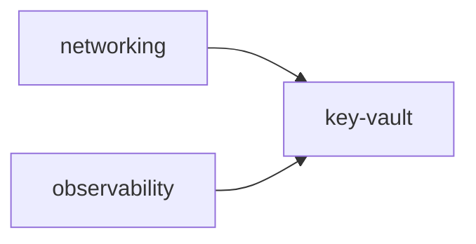

# Post-merge `v0.1` Design Changes (A/B/C) Implementation Plan

> **For agentic workers:** REQUIRED SUB-SKILL: Use superpowers:subagent-driven-development (recommended) or superpowers:executing-plans to implement this plan task-by-task. Steps use checkbox (`- [ ]`) syntax for tracking.

**Goal:** Land three agreed changes to the merged `v0.1` landing zone as one
change set: remove the `identity` Terraform stack (the three Entra groups
become admin-managed, their object IDs enter the other stacks as variables),
swap the CI OIDC app registrations for user-assigned managed identities, and
rename the repo default branch `master` → `main`.

**Architecture:** All three changes shrink the repo's directory-write surface
to zero. **A** deletes `environments/dev/identity/` and replaces its
`terraform_remote_state` outputs with three GitHub repository variables
(`HUMANS_GROUP_OBJECT_ID`, `CI_PLAN_GROUP_OBJECT_ID`, `CI_APPLY_GROUP_OBJECT_ID`)
consumed by `networking`, `observability`, and `key-vault`; the dependency
graph collapses from three tiers to two. **B** rewrites `bootstrap/` to create
`azurerm_user_assigned_identity` + `azurerm_federated_identity_credential`
pairs in the `rg-sap-dev-bootstrap` resource group instead of
`azuread_application` / `azuread_service_principal` /
`azuread_application_federated_identity_credential`; this removes the `azuread`
provider from the repo entirely. **C** is a git/GitHub operation with no
in-repo file changes — `ci.yml` and `bootstrap/`'s federated-credential
subject already hardcode `main`.

**Tech Stack:** Terraform >= 1.6 (CI/local pinned 1.16.0), `azurerm` provider
`~> 4.0` (only — `azuread` is removed), GitHub Actions with OIDC
(`id-token: write`), tflint + azurerm ruleset, trivy config scan, `gh` CLI.

**Spec:** `docs/superpowers/specs/2026-09-02-v0.1-landing-zone-design.md`
(this plan adds the `2026-09-06` amendment to it — Task 4).

## Global Constraints

- Modules stay pinned: `source = "github.com/jmsalvo/terraform-azure-modules//modules/<name>?ref=v0.1.0"` — never `?ref=main`.
- One Terraform state file per stack; cross-stack references only via `terraform_remote_state`, never hardcoded IDs. Group object IDs are **not** a cross-stack reference after this change — they are external inputs (repo variables), the same pattern already used for `tfstate_storage_account_name`.
- No stored Azure client secret anywhere (CI or local) — OIDC / `az login` only.
- No Microsoft Graph writes and no `azuread` provider anywhere in the repo after this change set. The three Entra groups (`sap-dev-humans`, `sap-dev-ci-plan`, `sap-dev-ci-apply`) are created and membership-managed by a directory admin outside this repo, as **assigned, cloud-only security groups**.
- Group → role mapping is unchanged: `sap-dev-humans` = `Contributor`, `sap-dev-ci-plan` = `Reader`, `sap-dev-ci-apply` = `Contributor`, each assigned per-resource-group by the stack that owns that resource group.
- Apply order after this change set: `networking` and `observability` in parallel (no upstream stack) → `key-vault` last (depends on both).
- `workload = "sap"`, `environment = "dev"`, `location = "eastus2"` across every stack.
- Nothing here can `terraform apply` for real yet — the tenant rollout is a later step. Every task's deliverable is `scripts/check.ps1` (`terraform fmt` / `validate` / `tflint` / `trivy`, all credential-free) passing, plus targeted greps and a YAML sanity check on `ci.yml`.
- **Execution environment note (from sessions 9–10):** the scoop shims directory `C:\Users\Jenni\scoop\shims` (holding `terraform`, `tflint`, `trivy`) is not always on `PATH` in a sandboxed session. If a tool is "not found", prepend that directory to `PATH` for the command. Shell state does not persist between tool calls.

---

## Task 1: Rename the default branch `master` → `main`

**Files:** none in the repo change. This is a git + GitHub repo-settings
operation. `ci.yml` (`on.push.branches: [main]`, `github.ref == 'refs/heads/main'`)
and `bootstrap/main.tf`'s federated-credential `subject`
(`repo:${var.github_repository}:ref:refs/heads/main`) already reference
`main`, so there is nothing to edit — only to make the branch name real.

**Interfaces:**
- Consumes: nothing.
- Produces: the remote default branch `main`, tracked locally. Tasks 2–4 branch from `main`.

**Run this on the primary clone (`C:\Users\Jenni\source\repos\portfolio\secure-azure-platform`), not in a worktree. Step 4 changes a GitHub repo setting — an external side effect; confirm before running.**

- [ ] **Step 1: Confirm the starting state**

```bash
cd secure-azure-platform
git status                    # expect: clean working tree
git branch --show-current     # expect: master
git rev-parse --abbrev-ref origin/HEAD   # expect: origin/master
```

- [ ] **Step 2: Rename the local branch**

```bash
git branch -m master main
```

- [ ] **Step 3: Push `main` and set upstream**

```bash
git push -u origin main
```

- [ ] **Step 4: Change the GitHub default branch**

```bash
gh repo edit jmsalvo/secure-azure-platform --default-branch main
```

- [ ] **Step 5: Delete the old remote branch and re-point local HEAD**

```bash
git push origin --delete master
git remote set-head origin -a          # updates origin/HEAD -> origin/main
git fetch origin --prune
```

- [ ] **Step 6: Verify**

```bash
gh repo view jmsalvo/secure-azure-platform --json defaultBranchRef -q .defaultBranchRef.name
# expect: main
git branch -a
# expect: * main, remotes/origin/main, no master anywhere
git rev-parse --abbrev-ref origin/HEAD
# expect: origin/main
```

- [ ] **Step 7: Branch-protection check (manual, no command)**

GitHub keeps branch rulesets keyed by branch-name pattern. Open
`jmsalvo/secure-azure-platform` → Settings → Rules → Rulesets. If any ruleset
targets `master`, retarget it to `main`. Per `plan/docs/status.md`, branch
protection on this repo may not be configured yet — if there are no rulesets,
there is nothing to do here; note it for the rollout step.

No commit — no repo files changed in this task.

---

## Task 2: `bootstrap/` — user-assigned managed identities instead of app registrations (change B)

**Files:**
- Modify: `bootstrap/versions.tf` (remove the `azuread` provider)
- Modify: `bootstrap/main.tf` (replace the CI-identity resources; fix role-assignment `principal_id` references)
- Modify: `bootstrap/outputs.tf` (rename the two SP-object-id outputs to principal-id outputs)
- Regenerate: `bootstrap/.terraform.lock.hcl` (drops the `azuread` entry)
- Rewrite: `bootstrap/README.md` (subscription Owner not Global Admin; no self-elevation; no Graph consent; the group-creation + member-add runbook; the three group-object-id repo variables)

**Interfaces:**
- Consumes: `var.github_repository` (unchanged), `var.location` (unchanged), `data.azurerm_client_config.current` (unchanged).
- Produces (Terraform outputs, read by hand after `apply`):
  `tfstate_resource_group_name`, `tfstate_storage_account_name`,
  `tfstate_container_name`, `tenant_id`, `subscription_id` (all unchanged);
  `ci_plan_client_id` (string, now `azurerm_user_assigned_identity.ci_plan.client_id`),
  `ci_apply_client_id` (string, now `azurerm_user_assigned_identity.ci_apply.client_id`),
  `ci_plan_principal_id` (string, **renamed** from `ci_plan_service_principal_object_id`, value `azurerm_user_assigned_identity.ci_plan.principal_id`),
  `ci_apply_principal_id` (string, **renamed** from `ci_apply_service_principal_object_id`, value `azurerm_user_assigned_identity.ci_apply.principal_id`).

- [ ] **Step 1: Rewrite `bootstrap/versions.tf`**

Full new content (the `azuread` provider block and `provider "azuread" {}`
line are removed; everything else is unchanged):

```hcl
terraform {
  required_version = ">= 1.6.0"

  required_providers {
    azurerm = {
      source  = "hashicorp/azurerm"
      version = "~> 4.0"
    }
  }

  # Local state deliberately: this config creates the remote-state backend
  # every other stack uses, so it can't use that backend itself.
}

provider "azurerm" {
  features {}
}

data "azurerm_client_config" "current" {}
```

- [ ] **Step 2: Rewrite the CI-identity section of `bootstrap/main.tf`**

Keep lines 1–41 exactly as they are: the `locals` block, `module "naming"`,
`azurerm_resource_group.bootstrap`, the `#trivy:ignore:AVD-AZU-0012` comment,
`azurerm_storage_account.tfstate`, and `azurerm_storage_container.tfstate`.

Replace everything from `resource "azuread_application" "ci_plan" {` to the
end of the file with:

```hcl
# CI identities: user-assigned managed identities federated to GitHub OIDC.
# Plain ARM resources in the bootstrap resource group — creating them needs
# only Contributor on that RG (you have subscription Owner), no directory
# role and no Microsoft Graph permission. A managed identity's principal is a
# valid RBAC target and Entra group member, exactly as an app registration's
# service principal was.
resource "azurerm_user_assigned_identity" "ci_plan" {
  name                = "sap-dev-ci-plan"
  resource_group_name = azurerm_resource_group.bootstrap.name
  location            = var.location
  tags                = module.naming.tags
}

resource "azurerm_federated_identity_credential" "ci_plan_pull_request" {
  name                = "github-pull-request"
  resource_group_name = azurerm_resource_group.bootstrap.name
  parent_id           = azurerm_user_assigned_identity.ci_plan.id
  audience            = ["api://AzureADTokenExchange"]
  issuer              = "https://token.actions.githubusercontent.com"
  subject             = "repo:${var.github_repository}:pull_request"
}

resource "azurerm_user_assigned_identity" "ci_apply" {
  name                = "sap-dev-ci-apply"
  resource_group_name = azurerm_resource_group.bootstrap.name
  location            = var.location
  tags                = module.naming.tags
}

resource "azurerm_federated_identity_credential" "ci_apply_main" {
  name                = "github-push-main"
  resource_group_name = azurerm_resource_group.bootstrap.name
  parent_id           = azurerm_user_assigned_identity.ci_apply.id
  audience            = ["api://AzureADTokenExchange"]
  issuer              = "https://token.actions.githubusercontent.com"
  subject             = "repo:${var.github_repository}:ref:refs/heads/main"
}

# shared_access_key_enabled = false on the state account means state access is
# Entra-ID-only; each CI identity needs an explicit data-plane role on the
# storage account to read/write the state blob (separate from the
# Reader/Contributor role its Entra group later gets on each resource group).
resource "azurerm_role_assignment" "tfstate_ci_plan_read" {
  scope                = azurerm_storage_account.tfstate.id
  role_definition_name = "Storage Blob Data Reader"
  principal_id         = azurerm_user_assigned_identity.ci_plan.principal_id
}

resource "azurerm_role_assignment" "tfstate_ci_apply_write" {
  scope                = azurerm_storage_account.tfstate.id
  role_definition_name = "Storage Blob Data Contributor"
  principal_id         = azurerm_user_assigned_identity.ci_apply.principal_id
}

# Blob access to the state account only gets CI as far as reading/writing
# state. The stacks themselves live at subscription scope: networking,
# observability and key-vault each create their own azurerm_resource_group,
# which no resource-group-scoped role can authorise.
resource "azurerm_role_assignment" "subscription_ci_plan_read" {
  scope                = local.subscription_scope
  role_definition_name = "Reader"
  principal_id         = azurerm_user_assigned_identity.ci_plan.principal_id
}

resource "azurerm_role_assignment" "subscription_ci_apply_contribute" {
  scope                = local.subscription_scope
  role_definition_name = "Contributor"
  principal_id         = azurerm_user_assigned_identity.ci_apply.principal_id
}

# Contributor explicitly excludes Microsoft.Authorization/*/Write, so it cannot
# create the azurerm_role_assignment resources each stack owns. RBAC
# Administrator is the least-privileged built-in that adds exactly that (role
# assignment management, no other data or control plane rights) — deliberately
# not Owner or User Access Administrator.
resource "azurerm_role_assignment" "subscription_ci_apply_rbac_admin" {
  scope                = local.subscription_scope
  role_definition_name = "Role Based Access Control Administrator"
  principal_id         = azurerm_user_assigned_identity.ci_apply.principal_id
}
```

- [ ] **Step 3: Rewrite `bootstrap/outputs.tf`**

Full new content. `tfstate_*`, `tenant_id`, `subscription_id` are unchanged;
the four CI outputs change value and two of them change name:

```hcl
output "tfstate_resource_group_name" {
  description = "Resource group holding the remote-state storage account."
  value       = azurerm_resource_group.bootstrap.name
}

output "tfstate_storage_account_name" {
  description = "Storage account holding every stack's remote state. Copy into each stack's backend.hcl."
  value       = azurerm_storage_account.tfstate.name
}

output "tfstate_container_name" {
  description = "Blob container holding every stack's remote state."
  value       = azurerm_storage_container.tfstate.name
}

output "ci_plan_client_id" {
  description = "Client ID of the sap-dev-ci-plan managed identity. Copy into the ARM_CLIENT_ID_PLAN GitHub repo variable."
  value       = azurerm_user_assigned_identity.ci_plan.client_id
}

output "ci_plan_principal_id" {
  description = "Principal (object) ID of the sap-dev-ci-plan managed identity. Add as a member of the sap-dev-ci-plan Entra group (see bootstrap/README.md)."
  value       = azurerm_user_assigned_identity.ci_plan.principal_id
}

output "ci_apply_client_id" {
  description = "Client ID of the sap-dev-ci-apply managed identity. Copy into the ARM_CLIENT_ID_APPLY GitHub repo variable."
  value       = azurerm_user_assigned_identity.ci_apply.client_id
}

output "ci_apply_principal_id" {
  description = "Principal (object) ID of the sap-dev-ci-apply managed identity. Add as a member of the sap-dev-ci-apply Entra group (see bootstrap/README.md)."
  value       = azurerm_user_assigned_identity.ci_apply.principal_id
}

output "tenant_id" {
  description = "Entra tenant ID. Copy into the ARM_TENANT_ID GitHub repo variable."
  value       = data.azurerm_client_config.current.tenant_id
}

output "subscription_id" {
  description = "Azure subscription ID. Copy into the ARM_SUBSCRIPTION_ID GitHub repo variable."
  value       = data.azurerm_client_config.current.subscription_id
}
```

- [ ] **Step 4: Regenerate `bootstrap/.terraform.lock.hcl`**

The lock file currently pins both `azuread` 3.9.0 and `azurerm` 4.81.0.
Delete it and re-lock for the two platforms the repo commits hashes for
(`linux_amd64` for CI, `windows_amd64` for local dev):

```bash
cd bootstrap
rm .terraform.lock.hcl
terraform init -backend=false
terraform providers lock -platform=linux_amd64 -platform=windows_amd64
cd ..
```

Verify the result contains only an `azurerm` block:

```bash
grep -c 'provider "registry.terraform.io/hashicorp/azuread"' bootstrap/.terraform.lock.hcl
# expect: 0
grep -c 'provider "registry.terraform.io/hashicorp/azurerm"' bootstrap/.terraform.lock.hcl
# expect: 1
```

- [ ] **Step 5: Rewrite `bootstrap/README.md`**

Full new content:

````markdown
# bootstrap

Real Terraform, **local state**, run **once by hand** — this is the
infrastructure that has to predate "clone and go" for every other stack:
the remote-state storage account, and the two managed identities CI
authenticates as via GitHub OIDC.

## Prerequisites

- An Azure subscription you are **Owner** of (needed to assign the
  subscription-scoped roles this config grants the CI identities). Subscription
  Owner is separate from any Entra directory role — you do **not** need a
  directory admin role for anything in this file.
- The three Entra groups already created by a directory admin — see step 4.
  `bootstrap` itself does not touch the directory, so this can happen before or
  after `terraform apply`, but the groups must exist before CI can run.
- `az login`.
- Terraform >= 1.6.

## Run it

```bash
cd bootstrap
cp terraform.tfvars.example terraform.tfvars   # edit if the repo isn't jmsalvo/secure-azure-platform
terraform init
terraform apply
```

If `apply` fails with `PrincipalNotFound` on one of the
`azurerm_role_assignment` resources, the managed identity's principal has not
finished replicating through the directory yet — wait a minute and re-run
`terraform apply` (it is idempotent).

## After `apply` — manual steps, in order

1. **Copy `tfstate_storage_account_name`** into the `storage_account_name`
   field of every `environments/dev/<stack>/backend.hcl` file (they ship with
   a `REPLACE_AFTER_BOOTSTRAP` placeholder). Commit the real value — it's an
   account name, not a secret.
2. **Set GitHub repository variables** (Settings → Secrets and variables →
   Actions → Variables — non-secret identifiers, safe as `vars`, not
   `secrets`):

   ```bash
   gh variable set ARM_TENANT_ID       --body "$(terraform output -raw tenant_id)"
   gh variable set ARM_SUBSCRIPTION_ID --body "$(terraform output -raw subscription_id)"
   gh variable set ARM_CLIENT_ID_PLAN  --body "$(terraform output -raw ci_plan_client_id)"
   gh variable set ARM_CLIENT_ID_APPLY --body "$(terraform output -raw ci_apply_client_id)"
   ```

   The `networking`, `observability`, and `key-vault` stacks each need the
   three Entra group object IDs, passed by CI as `-var` flags. Get them from
   the directory admin, or read them yourself once you own the groups
   (step 4):

   ```bash
   gh variable set HUMANS_GROUP_OBJECT_ID   --body "$(az ad group show --group sap-dev-humans   --query id -o tsv)"
   gh variable set CI_PLAN_GROUP_OBJECT_ID  --body "$(az ad group show --group sap-dev-ci-plan  --query id -o tsv)"
   gh variable set CI_APPLY_GROUP_OBJECT_ID --body "$(az ad group show --group sap-dev-ci-apply --query id -o tsv)"
   ```
3. **Create a GitHub Environment** named `dev-apply` (Settings →
   Environments) with required reviewers. It is already referenced by the
   `apply_networking` / `apply_observability` / `apply_key_vault` jobs in
   `.github/workflows/ci.yml`.
4. **Entra groups — directory admin, one-time.** The admin creates three
   **assigned, cloud-only security groups** — `sap-dev-humans`,
   `sap-dev-ci-plan`, `sap-dev-ci-apply` — (not dynamic: membership is hand
   managed; not on-prem-synced: membership lives in Entra) and makes **you an
   owner** of each. That is the admin's entire involvement.

   Then, as a group owner (no directory role required), add the members:

   ```bash
   az ad group member add --group sap-dev-humans   --member-id "$(az ad signed-in-user show --query id -o tsv)"
   az ad group member add --group sap-dev-ci-plan  --member-id "$(terraform output -raw ci_plan_principal_id)"
   az ad group member add --group sap-dev-ci-apply --member-id "$(terraform output -raw ci_apply_principal_id)"
   ```

   A freshly created managed-identity principal can lag directory
   replication — if `member add` reports the principal "does not exist", wait
   a minute and retry.

   No Microsoft Graph application permission and no admin consent is needed
   anywhere: nothing in this repo writes to the directory.

## Teardown

Nothing here is meant to be torn down casually — deleting the storage account
destroys every other stack's state. If the whole landing zone is being
decommissioned, delete stacks in reverse dependency order first
(`key-vault` → `networking` / `observability`), then `terraform destroy` here.
The Entra groups are the directory admin's to remove.

One trap worth knowing before you destroy the `key-vault` stack: the pinned
`key-vault` module defaults to `purge_protection_enabled = true` and
`soft_delete_retention_days = 90`, so `terraform destroy` leaves a
soft-deleted vault behind that **cannot be purged** and blocks recreating a
vault with the same name for the full 90 days. Vault names are deterministic
(`module.naming`), so a destroy/recreate cycle in `dev` will fail on name
collision until the retention window expires.
````

- [ ] **Step 6: Verify**

```bash
terraform -chdir=bootstrap fmt
.\scripts\check.ps1
```
Expected: `All checks passed.`

```bash
git grep -n '"azuread"' -- bootstrap
git grep -n 'azuread_' -- bootstrap
```
Expected: no matches for either.

- [ ] **Step 7: Commit**

```bash
git add bootstrap
git commit -m "feat(bootstrap): user-assigned managed identities for CI, not app registrations"
```

---

## Task 3: Remove the `identity` stack; group object IDs become input variables (change A)

**Files:**
- Delete: `environments/dev/identity/` (all seven files: `versions.tf`, `variables.tf`, `main.tf`, `outputs.tf`, `backend.hcl`, `terraform.tfvars.example`, `README.md`, and the committed `.terraform.lock.hcl`)
- Modify: `environments/dev/networking/variables.tf`, `environments/dev/networking/main.tf`
- Modify: `environments/dev/observability/variables.tf`, `environments/dev/observability/main.tf`
- Modify: `environments/dev/key-vault/variables.tf`, `environments/dev/key-vault/main.tf`
- Modify: `.github/workflows/ci.yml`

**Interfaces:**
- Consumes: three new GitHub repository variables set in Task 2's README
  runbook — `HUMANS_GROUP_OBJECT_ID`, `CI_PLAN_GROUP_OBJECT_ID`,
  `CI_APPLY_GROUP_OBJECT_ID` (all string). Each is passed to `networking`,
  `observability`, and `key-vault` by CI as `-var="humans_group_object_id=..."`
  / `-var="ci_plan_group_object_id=..."` / `-var="ci_apply_group_object_id=..."`.
- Produces: unchanged stack outputs (`networking`: `vnet_id`,
  `platform_subnet_id`; `observability`: `log_analytics_workspace_id`;
  `key-vault`: `key_vault_id`, `key_vault_uri`). The `identity` stack's three
  outputs no longer exist.

- [ ] **Step 1: Delete the `identity` stack**

```bash
git rm -r environments/dev/identity
```

- [ ] **Step 2: Add the three group-object-id variables to each consuming stack**

Append this identical block to **each** of
`environments/dev/networking/variables.tf`,
`environments/dev/observability/variables.tf`, and
`environments/dev/key-vault/variables.tf` (they currently end after the
`tfstate_storage_account_name` variable):

```hcl

variable "humans_group_object_id" {
  description = "Object ID of the admin-precreated sap-dev-humans Entra group (GitHub repo variable HUMANS_GROUP_OBJECT_ID)."
  type        = string
}

variable "ci_plan_group_object_id" {
  description = "Object ID of the admin-precreated sap-dev-ci-plan Entra group (GitHub repo variable CI_PLAN_GROUP_OBJECT_ID)."
  type        = string
}

variable "ci_apply_group_object_id" {
  description = "Object ID of the admin-precreated sap-dev-ci-apply Entra group (GitHub repo variable CI_APPLY_GROUP_OBJECT_ID)."
  type        = string
}
```

- [ ] **Step 3: Rewire `environments/dev/networking/main.tf`**

Delete the `data "terraform_remote_state" "identity"` block entirely (the
first 11 lines, through the closing `}` and its trailing blank line). The
file then starts with `module "naming"`.

Change the three `azurerm_role_assignment` resources near the end of the file
so `principal_id` reads from a variable instead of the deleted remote state.
The three resources become exactly:

```hcl
resource "azurerm_role_assignment" "humans_contributor" {
  scope                = azurerm_resource_group.networking.id
  role_definition_name = "Contributor"
  principal_id         = var.humans_group_object_id
}

resource "azurerm_role_assignment" "ci_plan_reader" {
  scope                = azurerm_resource_group.networking.id
  role_definition_name = "Reader"
  principal_id         = var.ci_plan_group_object_id
}

resource "azurerm_role_assignment" "ci_apply_contributor" {
  scope                = azurerm_resource_group.networking.id
  role_definition_name = "Contributor"
  principal_id         = var.ci_apply_group_object_id
}
```

- [ ] **Step 4: Rewire `environments/dev/observability/main.tf`**

Delete the `data "terraform_remote_state" "identity"` block entirely (first
11 lines). Change the three `azurerm_role_assignment` resources to:

```hcl
resource "azurerm_role_assignment" "humans_contributor" {
  scope                = azurerm_resource_group.observability.id
  role_definition_name = "Contributor"
  principal_id         = var.humans_group_object_id
}

resource "azurerm_role_assignment" "ci_plan_reader" {
  scope                = azurerm_resource_group.observability.id
  role_definition_name = "Reader"
  principal_id         = var.ci_plan_group_object_id
}

resource "azurerm_role_assignment" "ci_apply_contributor" {
  scope                = azurerm_resource_group.observability.id
  role_definition_name = "Contributor"
  principal_id         = var.ci_apply_group_object_id
}
```

- [ ] **Step 5: Rewire `environments/dev/key-vault/main.tf`**

Delete **only** the `data "terraform_remote_state" "identity"` block (the
first 11 lines). Keep `data "terraform_remote_state" "networking"` and
`data "terraform_remote_state" "observability"` — those are still real
cross-stack dependencies.

Change the four `azurerm_role_assignment` resources at the end of the file to:

```hcl
resource "azurerm_role_assignment" "humans_contributor" {
  scope                = azurerm_resource_group.key_vault.id
  role_definition_name = "Contributor"
  principal_id         = var.humans_group_object_id
}

resource "azurerm_role_assignment" "ci_plan_reader" {
  scope                = azurerm_resource_group.key_vault.id
  role_definition_name = "Reader"
  principal_id         = var.ci_plan_group_object_id
}

resource "azurerm_role_assignment" "ci_apply_contributor" {
  scope                = azurerm_resource_group.key_vault.id
  role_definition_name = "Contributor"
  principal_id         = var.ci_apply_group_object_id
}

# RG-level Contributor manages the vault as an ARM resource but does not grant
# data-plane access (the module sets enable_rbac_authorization = true, no
# access policies) — humans additionally need a Key Vault data-plane role to
# actually read/write secrets.
resource "azurerm_role_assignment" "humans_secrets_officer" {
  scope                = module.key_vault.id
  role_definition_name = "Key Vault Secrets Officer"
  principal_id         = var.humans_group_object_id
}
```

- [ ] **Step 6: Edit `.github/workflows/ci.yml` — the `changes` job**

Remove the `identity` output line and the `identity:` filter entry. The job
becomes:

```yaml
  changes:
    runs-on: ubuntu-latest
    outputs:
      networking: ${{ steps.filter.outputs.networking }}
      observability: ${{ steps.filter.outputs.observability }}
      key_vault: ${{ steps.filter.outputs.key_vault }}
    steps:
      - uses: actions/checkout@v4
      - uses: dorny/paths-filter@v3
        id: filter
        with:
          filters: |
            networking:
              - 'environments/dev/networking/**'
            observability:
              - 'environments/dev/observability/**'
            key_vault:
              - 'environments/dev/key-vault/**'
```

- [ ] **Step 7: Edit `.github/workflows/ci.yml` — delete the `plan-identity` and `apply_identity` jobs**

Delete the entire `plan-identity:` job block and the entire `apply_identity:`
job block. The `IDENTITY_HUMAN_OPERATOR_OBJECT_ID`,
`IDENTITY_CI_PLAN_SP_OBJECT_ID`, and `IDENTITY_CI_APPLY_SP_OBJECT_ID`
repository variables are only referenced by those two jobs and are now unused
(they can be deleted from the GitHub repo settings separately — not a repo
file change).

- [ ] **Step 8: Edit `.github/workflows/ci.yml` — add the group-id `-var` flags to the three `plan-*` jobs**

In `plan-networking`, `plan-observability`, and `plan-key-vault`, the final
`run:` step currently ends with a single-line `terraform plan`. Replace that
`terraform plan` line with the multi-line form below (the `working-directory`
and `storage_account=...` / `terraform init` lines above it are unchanged):

`plan-networking`:

```yaml
      - working-directory: environments/dev/networking
        run: |
          storage_account="$(grep storage_account_name backend.hcl | cut -d'"' -f2)"
          terraform init -backend-config=backend.hcl -lockfile=readonly
          terraform plan -input=false -no-color \
            -var="tfstate_storage_account_name=${storage_account}" \
            -var="humans_group_object_id=${{ vars.HUMANS_GROUP_OBJECT_ID }}" \
            -var="ci_plan_group_object_id=${{ vars.CI_PLAN_GROUP_OBJECT_ID }}" \
            -var="ci_apply_group_object_id=${{ vars.CI_APPLY_GROUP_OBJECT_ID }}"
```

`plan-observability`: identical, with `working-directory: environments/dev/observability`.

`plan-key-vault`: identical, with `working-directory: environments/dev/key-vault`.

- [ ] **Step 9: Edit `.github/workflows/ci.yml` — rewrite `apply_networking`**

With `apply_identity` gone, `apply_networking` has no *skippable* dependency
left, so the `always()` workaround — and the hand-rolled
`needs.<job>.result == 'success'` checks it forced — is no longer needed:
GitHub's implicit `success()` gate over the `needs:` list is exactly the
right behaviour (a failed `fmt` / `validate` / `tflint` / `trivy` skips this
job). Replace the whole `apply_networking:` job — from its leading comment
block down to the end of its `run:` step — with:

```yaml
  apply_networking:
    if: >-
      github.event_name == 'push' &&
      github.ref == 'refs/heads/main' &&
      needs.changes.outputs.networking == 'true'
    needs: [fmt, validate, tflint, trivy, changes]
    runs-on: ubuntu-latest
    environment: dev-apply
    # One apply at a time per stack: two merges to main in quick succession
    # otherwise race for the same state blob. Queue, never cancel — cancelling
    # a running apply mid-flight is how state gets left inconsistent.
    concurrency:
      group: apply-networking
      cancel-in-progress: false
    permissions:
      contents: read
      id-token: write
    env:
      ARM_CLIENT_ID: ${{ vars.ARM_CLIENT_ID_APPLY }}
      ARM_TENANT_ID: ${{ vars.ARM_TENANT_ID }}
      ARM_SUBSCRIPTION_ID: ${{ vars.ARM_SUBSCRIPTION_ID }}
      ARM_USE_OIDC: "true"
    steps:
      - uses: actions/checkout@v4
      - uses: hashicorp/setup-terraform@v3
        with:
          terraform_version: ${{ env.TERRAFORM_VERSION }}
      - working-directory: environments/dev/networking
        run: |
          storage_account="$(grep storage_account_name backend.hcl | cut -d'"' -f2)"
          terraform init -backend-config=backend.hcl -lockfile=readonly
          terraform apply -input=false -auto-approve -no-color \
            -var="tfstate_storage_account_name=${storage_account}" \
            -var="humans_group_object_id=${{ vars.HUMANS_GROUP_OBJECT_ID }}" \
            -var="ci_plan_group_object_id=${{ vars.CI_PLAN_GROUP_OBJECT_ID }}" \
            -var="ci_apply_group_object_id=${{ vars.CI_APPLY_GROUP_OBJECT_ID }}"
```

- [ ] **Step 10: Edit `.github/workflows/ci.yml` — rewrite `apply_observability`**

Same treatment. Replace the whole `apply_observability:` job — from its
leading `# The explicit needs.*.result checks are load-bearing — see
apply_networking.` comment down to the end of its `run:` step — with:

```yaml
  apply_observability:
    if: >-
      github.event_name == 'push' &&
      github.ref == 'refs/heads/main' &&
      needs.changes.outputs.observability == 'true'
    needs: [fmt, validate, tflint, trivy, changes]
    runs-on: ubuntu-latest
    environment: dev-apply
    # See apply_networking: serialise applies against this stack's state.
    concurrency:
      group: apply-observability
      cancel-in-progress: false
    permissions:
      contents: read
      id-token: write
    env:
      ARM_CLIENT_ID: ${{ vars.ARM_CLIENT_ID_APPLY }}
      ARM_TENANT_ID: ${{ vars.ARM_TENANT_ID }}
      ARM_SUBSCRIPTION_ID: ${{ vars.ARM_SUBSCRIPTION_ID }}
      ARM_USE_OIDC: "true"
    steps:
      - uses: actions/checkout@v4
      - uses: hashicorp/setup-terraform@v3
        with:
          terraform_version: ${{ env.TERRAFORM_VERSION }}
      - working-directory: environments/dev/observability
        run: |
          storage_account="$(grep storage_account_name backend.hcl | cut -d'"' -f2)"
          terraform init -backend-config=backend.hcl -lockfile=readonly
          terraform apply -input=false -auto-approve -no-color \
            -var="tfstate_storage_account_name=${storage_account}" \
            -var="humans_group_object_id=${{ vars.HUMANS_GROUP_OBJECT_ID }}" \
            -var="ci_plan_group_object_id=${{ vars.CI_PLAN_GROUP_OBJECT_ID }}" \
            -var="ci_apply_group_object_id=${{ vars.CI_APPLY_GROUP_OBJECT_ID }}"
```

- [ ] **Step 11: Edit `.github/workflows/ci.yml` — `apply_key_vault`**

`apply_key_vault` still depends on the *skippable* `apply_networking` /
`apply_observability`, so it keeps `always()` and the explicit
`needs.<job>.result == 'success'` checks. But its two comments currently
point at jobs/patterns that are changing: the top comment says "see
apply_networking" (which no longer demonstrates the pattern) and the
`concurrency` comment says "See apply_identity for why" (deleted). Rewrite
both so the job is self-contained. Replace `apply_key_vault`'s leading
comment and its `if:` / `needs:` with:

```yaml
  apply_key_vault:
    # always() is required so this job still runs when apply_networking /
    # apply_observability are *skipped* (that stack unchanged in this push).
    # always() also disables GitHub's implicit success() gate over the whole
    # needs: list, so the fmt / validate / tflint / trivy results are
    # re-checked by hand below — without those explicit checks a failing
    # credential-free check could not block this live terraform apply (the
    # hole fixed in 02d3842). Removing any of the result checks reopens it.
    if: >-
      always() &&
      github.event_name == 'push' &&
      github.ref == 'refs/heads/main' &&
      needs.fmt.result == 'success' &&
      needs.validate.result == 'success' &&
      needs.tflint.result == 'success' &&
      needs.trivy.result == 'success' &&
      needs.changes.result == 'success' &&
      needs.changes.outputs.key_vault == 'true' &&
      (needs.apply_networking.result == 'success' || needs.apply_networking.result == 'skipped') &&
      (needs.apply_observability.result == 'success' || needs.apply_observability.result == 'skipped')
    needs: [fmt, validate, tflint, trivy, changes, apply_networking, apply_observability]
```

Change its `concurrency` comment from `# See apply_identity for why: ...` to
`# See apply_networking: serialise applies against this stack's state.`
Leave `runs-on`, `environment`, `permissions`, and `env:` unchanged. Update
the final `run:` step to pass the group-id vars:

```yaml
      - working-directory: environments/dev/key-vault
        run: |
          storage_account="$(grep storage_account_name backend.hcl | cut -d'"' -f2)"
          terraform init -backend-config=backend.hcl -lockfile=readonly
          terraform apply -input=false -auto-approve -no-color \
            -var="tfstate_storage_account_name=${storage_account}" \
            -var="humans_group_object_id=${{ vars.HUMANS_GROUP_OBJECT_ID }}" \
            -var="ci_plan_group_object_id=${{ vars.CI_PLAN_GROUP_OBJECT_ID }}" \
            -var="ci_apply_group_object_id=${{ vars.CI_APPLY_GROUP_OBJECT_ID }}"
```

- [ ] **Step 12: Verify**

```bash
terraform -chdir=environments/dev/networking fmt
terraform -chdir=environments/dev/observability fmt
terraform -chdir=environments/dev/key-vault fmt
.\scripts\check.ps1
```
Expected: `All checks passed.` (`terraform validate` runs against `bootstrap`
+ the three remaining stacks; the git-sourced `naming` / `networking` /
`key-vault` modules are fetched over the network during `init`).

```bash
python -c "import yaml; yaml.safe_load(open('.github/workflows/ci.yml')); print('ci.yml: valid YAML')"
```
If Python/PyYAML is unavailable, print a note and rely on GitHub's validation
on first push.

```bash
git grep -n 'identity'  -- environments .github
git grep -n 'terraform_remote_state" "identity'
git grep -n 'IDENTITY_'  -- .github
```
Expected: no matches for any of the three.

- [ ] **Step 13: Commit**

```bash
git add environments .github
git commit -m "refactor: remove the identity stack; group object IDs are now input variables"
```

---

## Task 4: Update the design docs (README, ADR 0001, spec, CHANGELOG)

**Files:**
- Modify: `README.md`
- Modify: `docs/decisions/0001-lifecycle-aligned-stacks.md`
- Modify: `docs/superpowers/specs/2026-09-02-v0.1-landing-zone-design.md`
- Modify: `CHANGELOG.md`

**Interfaces:**
- Consumes: nothing — this task only records what Tasks 1–3 did.
- Produces: nothing consumed by later work.

- [ ] **Step 1: `README.md` — stack diagram and table**

Replace the mermaid block:



Replace the stack table with:

```markdown
| Stack | Creates | Depends on |
|---|---|---|
| [`networking`](environments/dev/networking) | VNet, subnet, RBAC | — |
| [`observability`](environments/dev/observability) | Log Analytics workspace, RBAC | — |
| [`key-vault`](environments/dev/key-vault) | Platform Key Vault, RBAC | `networking`, `observability` |

The three Entra RBAC groups (`sap-dev-humans` = `Contributor`,
`sap-dev-ci-plan` = `Reader`, `sap-dev-ci-apply` = `Contributor`) are created
and membership-managed by a directory admin outside this repo, as assigned
cloud-only security groups. Their object IDs enter each stack as GitHub
repository variables (`HUMANS_GROUP_OBJECT_ID`, `CI_PLAN_GROUP_OBJECT_ID`,
`CI_APPLY_GROUP_OBJECT_ID`) — see [`bootstrap/README.md`](bootstrap/README.md).
```

In the paragraph that begins "Modules come from the already-released", change
the parenthetical "(`identity`'s groups, `observability`'s workspace — no
module wraps a single resource)" to "(`observability`'s Log Analytics
workspace — no module wraps a single resource)".

- [ ] **Step 2: `README.md` — first-time rollout**

Replace the numbered list under "## First-time rollout" with:

```markdown
1. `bootstrap/` — run once by hand (`bootstrap/README.md`). Creates the state
   storage account and the two CI managed identities.
2. Complete the manual steps in `bootstrap/README.md` — GitHub repository
   variables (including the three Entra group object IDs), the `dev-apply`
   environment, and the directory admin's one-time group creation plus the
   member adds.
3. Merge a PR touching `environments/dev/networking/` and
   `environments/dev/observability/` (together or separately — neither has an
   upstream stack).
4. Merge a PR touching `environments/dev/key-vault/` — needs `networking` and
   `observability` to have real applied state.

After this, ordinary changes to any one stack merge and apply normally; this
sequence only matters once, from an empty subscription.
```

- [ ] **Step 3: `README.md` — security considerations**

Add this bullet to the "## Security considerations" list, after the "No
stored Azure client secret" bullet:

```markdown
- No Microsoft Graph or directory write access anywhere. The CI identities
  are user-assigned managed identities with Azure RBAC only; the Entra groups
  they belong to are created and membership-managed by a directory admin
  outside this repo. A compromised CI identity cannot alter group membership
  or any other directory object.
```

- [ ] **Step 4: `docs/decisions/0001-lifecycle-aligned-stacks.md`**

Change the status line to:

```markdown
- **Status:** Accepted (amended 2026-09-06)
```

In the `## Decision` section, replace the four-bullet stack list with:

```markdown
- `networking/` — VNet, subnets. No dependencies.
- `observability/` — Log Analytics workspace. No dependencies.
- `key-vault/` — the platform Key Vault. Depends on `networking` and
  `observability` (subnet ID, workspace ID).

The three Entra RBAC groups are not a stack — they are created by a directory
admin outside this repo and their object IDs are passed to each stack as
input variables (see the 2026-09-06 amendment).
```

In `## Consequences`, change "Four `terraform init`/`plan`/`apply` cycles
instead of one" to "Three `terraform init`/`plan`/`apply` cycles instead of
one".

Add a new section immediately before `## Revisit when`:

```markdown
## Amendment — 2026-09-06

The original decision included a fourth stack, `identity/`, that created the
three Entra RBAC groups and their `azuread_group_member` assignments. It has
been removed. The deployment tenant is not owned by the operator and grants
no directory admin role, so a directory admin now pre-creates the three groups
(assigned, cloud-only security groups) and adds their members by hand; the
group object IDs enter `networking`, `observability`, and `key-vault` as
GitHub repository variables instead of via `terraform_remote_state`. This
removes the last Microsoft Graph write from the repo and collapses the
dependency graph from three tiers to two — `networking` and `observability`
now have no upstream stack. The lifecycle-alignment rationale above is
unchanged for the stacks that remain. Planned in
`docs/superpowers/plans/2026-09-06-post-merge-design-changes.md`.
```

- [ ] **Step 5: `docs/superpowers/specs/2026-09-02-v0.1-landing-zone-design.md` — amendment header**

Immediately after the `- **Status:** Approved` / `- **Date:** 2026-09-02`
lines, insert:

```markdown
- **Amended:** 2026-09-06 — see "Amendment" below.

## Amendment — 2026-09-06 (change set A/B/C)

Three changes agreed after `v0.1` merged, planned in
`docs/superpowers/plans/2026-09-06-post-merge-design-changes.md`:

- **A. The `identity` stack is removed.** The deployment tenant is not the
  operator's and carries no directory admin role. A directory admin
  pre-creates the three Entra groups (`sap-dev-humans`, `sap-dev-ci-plan`,
  `sap-dev-ci-apply`) as assigned, cloud-only security groups and adds their
  members by hand. The group object IDs are passed to `networking`,
  `observability`, and `key-vault` as GitHub repository variables, replacing
  the `terraform_remote_state` reads of `identity`'s outputs. No Microsoft
  Graph writes remain anywhere in the repo; there is no `identity` state file
  and no `plan` / `apply` job for it.
- **B. The CI OIDC identities are user-assigned managed identities**, not app
  registrations + service principals. `bootstrap/` creates them in the
  `rg-sap-dev-bootstrap` resource group (plain ARM resources, no directory
  permission) and federates them to GitHub OIDC identically. Their principals
  are still valid RBAC targets and Entra group members. This removes the
  `azuread` provider from the repo entirely and the conditional "Application
  Developer" admin ask.
- **C. The repository default branch is renamed `master` → `main`**, matching
  what `.github/workflows/ci.yml` and `bootstrap/`'s federated-credential
  subject already hardcode.

Effect on the tiers described in "Stacks & state organization" and "CI
ordering": two tiers now — `networking` and `observability` (no upstream
stack) → `key-vault` (depends on both).
```

- [ ] **Step 6: `docs/superpowers/specs/2026-09-02-v0.1-landing-zone-design.md` — inline markers**

Add a one-line blockquote at the very start of each of these sections (right
under the `##` heading), so a reader who jumps straight to a section is
pointed at the amendment:

Under `## Context`:

```markdown
> **Amended 2026-09-06:** the "personal subscription + Entra tenant with
> Global Admin" assumption below is superseded — the real target is a
> subscription the operator owns inside a tenant they do not, with a
> cooperative directory admin. See the Amendment above.
```

Under `## Stacks & state organization`:

```markdown
> **Amended 2026-09-06:** there is no `identity` stack. The three
> dependency tiers below are now two (`networking` / `observability` →
> `key-vault`). See the Amendment above.
```

Under `## Entra RBAC groups`:

```markdown
> **Amended 2026-09-06:** the three groups are created and
> membership-managed by a directory admin outside this repo; their object
> IDs enter each stack as GitHub repository variables. The role split below
> (`plan` = Reader, `apply` = Contributor) is unchanged. The
> "**Dependency to document, not solve here**" note about a
> `Group.ReadWrite.All` Graph permission no longer applies — nothing in the
> repo writes to the directory. See the Amendment above.
```

Under `## CI ordering`:

```markdown
> **Amended 2026-09-06:** `identity` is no longer in the job graph;
> `networking` and `observability` have no upstream `apply` job.
```

- [ ] **Step 7: `CHANGELOG.md`**

Under `## [Unreleased]` → `### Added`:

- Delete the line `- environments/dev/identity/: the three Entra RBAC groups`.
- Change `- bootstrap/: one-time state storage account + OIDC app registrations for CI`
  to `- bootstrap/: one-time state storage account + user-assigned managed identities (GitHub OIDC federated) for CI`.
- Change `- committed `.terraform.lock.hcl` for bootstrap and all four stacks`
  to `- committed `.terraform.lock.hcl` for bootstrap and all three stacks`.

Add a new `### Changed` section between `### Added` and `### Fixed`:

```markdown
### Changed

- Default branch renamed `master` → `main` (matches what `ci.yml` and
  `bootstrap/`'s federated-credential subject already reference).
- `networking`, `observability`, and `key-vault` take the three Entra group
  object IDs as input variables (GitHub repo variables `HUMANS_GROUP_OBJECT_ID`
  / `CI_PLAN_GROUP_OBJECT_ID` / `CI_APPLY_GROUP_OBJECT_ID`) instead of reading
  them from the `identity` stack's remote state.
```

Add a `### Removed` section immediately after `### Changed`:

```markdown
### Removed

- `environments/dev/identity/`. The three Entra RBAC groups are now created
  and membership-managed by a directory admin outside this repo (assigned,
  cloud-only security groups); the repo makes no Microsoft Graph writes and
  the `azuread` provider is gone. Stack dependency graph drops from three
  tiers to two.
```

- [ ] **Step 8: Verify**

```bash
.\scripts\check.ps1
```
Expected: `All checks passed.` (docs don't affect it, but confirm nothing
regressed).

```bash
git grep -n 'identity' -- README.md docs/decisions CHANGELOG.md docs/superpowers/specs
```
Read each hit. Every remaining occurrence must be inside an amendment /
changelog entry that is *describing the removal as history*. There must be no
surviving statement that presents `environments/dev/identity/` as a current
stack.

```bash
git grep -n 'four stacks\|all four\|three tiers\|Global Admin\|app registration' -- README.md docs CHANGELOG.md
```
Each hit must likewise be historical (inside an amendment or a "was X, now Y"
sentence), not a current claim.

- [ ] **Step 9: Commit**

```bash
git add README.md docs CHANGELOG.md
git commit -m "docs: record change set A/B/C (no identity stack, managed identities, main branch)"
```

---

## Self-Review Notes

- **Spec coverage.** The three amendment items map 1:1 to the change set:
  A → Task 3, B → Task 2, C → Task 1; Task 4 records all three in the spec,
  ADR 0001, README, and CHANGELOG. The spec's role-split design (plan =
  Reader, apply = Contributor) and its resource-group model are untouched and
  still implemented by the three remaining stacks.
- **Deviation from the session-11 note.** `plan/docs/status.md` "Next up" item
  1 said to *update* `identity/README.md`. Today's decision (delete the
  stack) means that file is removed with the directory in Task 3, not edited —
  noted here so the deviation is deliberate, not an omission.
- **`master` string check.** `git grep master` over the repo (excluding
  `.git/`) returns nothing before this change set, so Task 1 needs no file
  edits — `ci.yml` and `bootstrap/main.tf` already say `main`. Verified during
  planning.
- **`always()` change is deliberate and scoped.** Task 3 Steps 9–10 remove
  `always()` from `apply_networking` / `apply_observability` only, because
  their sole skippable dependency (`apply_identity`) is gone; GitHub's
  implicit `success()` gate over `[fmt, validate, tflint, trivy, changes]` is
  then the correct and simpler gate. Step 11 keeps `apply_key_vault`'s
  `always()` and its explicit `needs.<job>.result == 'success'` checks —
  `apply_networking` / `apply_observability` are still legitimately skipped
  when unchanged — and only rewrites its two now-dangling comments (which
  referenced `apply_networking`'s pattern and the deleted `apply_identity`)
  so the job is self-contained. This is the exact hole fixed in commit
  `02d3842` and it stays closed.
- **Lock files.** Only `bootstrap/.terraform.lock.hcl` changes (drops
  `azuread`); it is regenerated for `linux_amd64` + `windows_amd64` to match
  the repo convention. The three remaining stacks' lock files already contain
  only `azurerm` and are untouched. `environments/dev/identity/.terraform.lock.hcl`
  is deleted with the directory.
- **Placeholder scan.** No `TBD` / "similar to" / "add error handling" —
  every HCL block, YAML block, and doc block is literal final content.
- **Type consistency.** `bootstrap` outputs renamed
  `ci_plan_service_principal_object_id` → `ci_plan_principal_id` and
  `ci_apply_service_principal_object_id` → `ci_apply_principal_id`; the only
  consumers were the deleted `identity` stack and `bootstrap/README.md`, and
  the new README (Task 2 Step 5) uses the new names. The new stack variables
  `humans_group_object_id` / `ci_plan_group_object_id` /
  `ci_apply_group_object_id` are defined identically in all three stacks
  (Task 3 Step 2) and referenced with those exact names in each `main.tf`
  (Steps 3–5) and in `ci.yml` (Steps 8–10).
- **Out of scope (unchanged by this plan):** the "approved apply is not the
  reviewed plan" known limitation in the README; the `bootstrap` trivy
  suppression; the deny-by-default NSG; `CONTRIBUTING.md` (its "adding a
  stack" guidance is generic and stays accurate).
- **Follow-ups outside this plan:** update `plan/docs/status.md` (different
  repo) to record this session; delete the now-unused
  `IDENTITY_HUMAN_OPERATOR_OBJECT_ID` / `IDENTITY_CI_PLAN_SP_OBJECT_ID` /
  `IDENTITY_CI_APPLY_SP_OBJECT_ID` GitHub repo variables if they were ever
  set; the live tenant rollout ("Next up" item 2).
